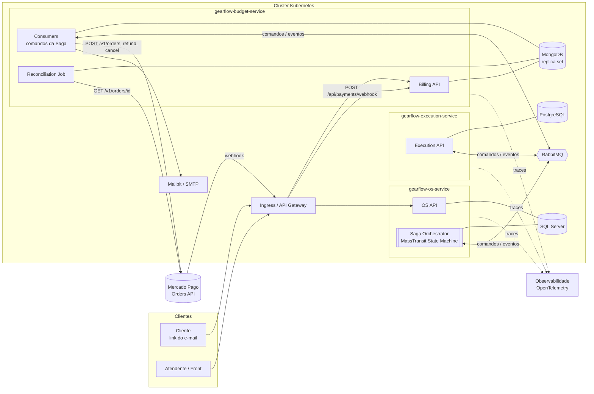
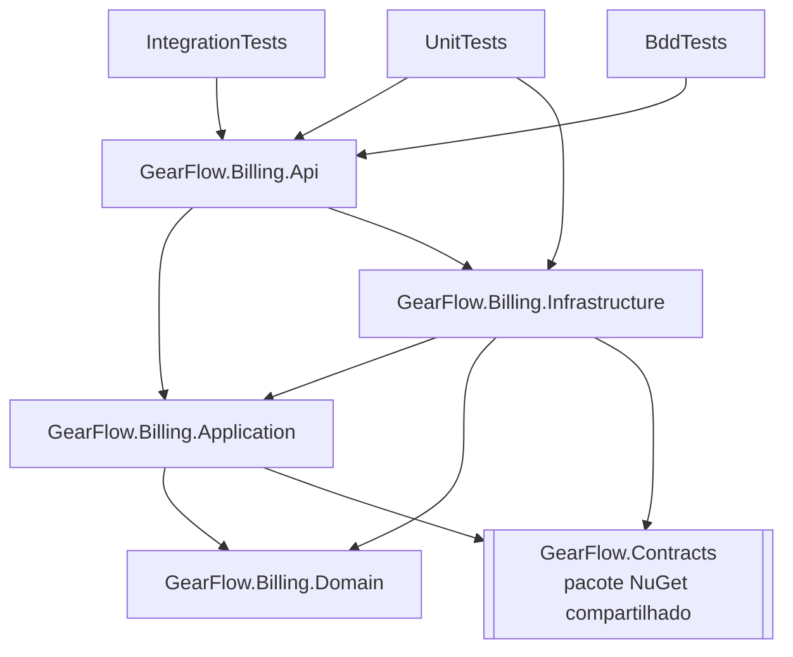
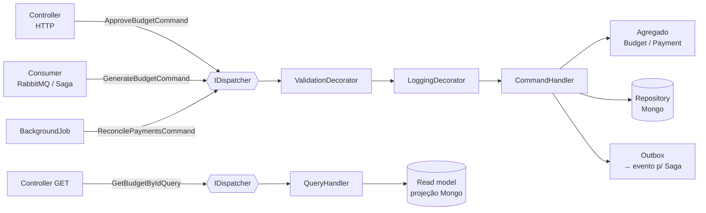
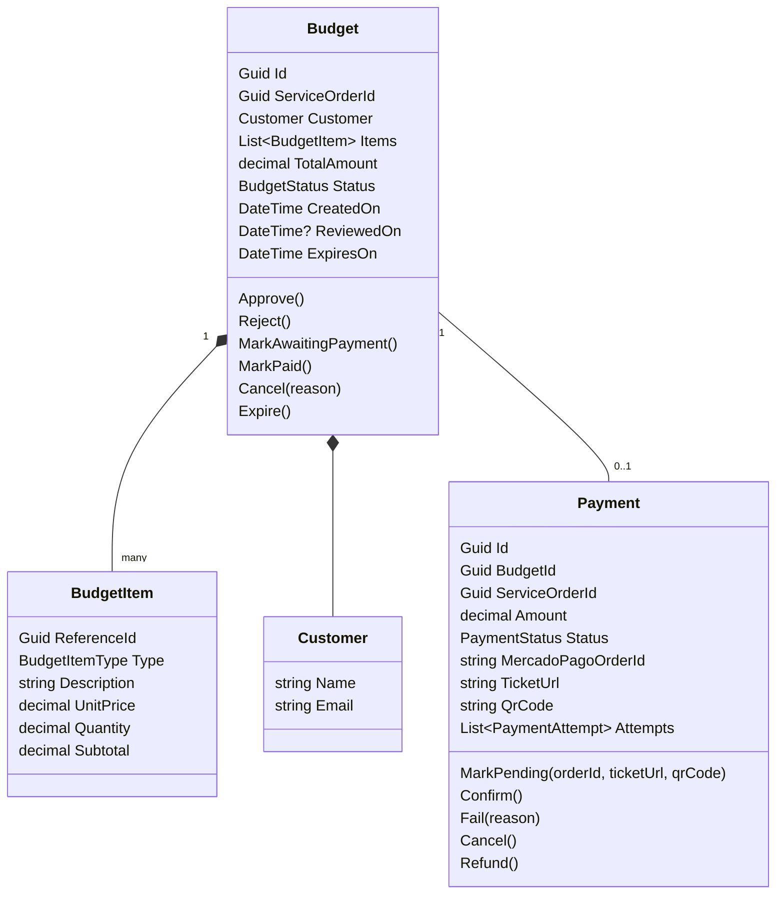
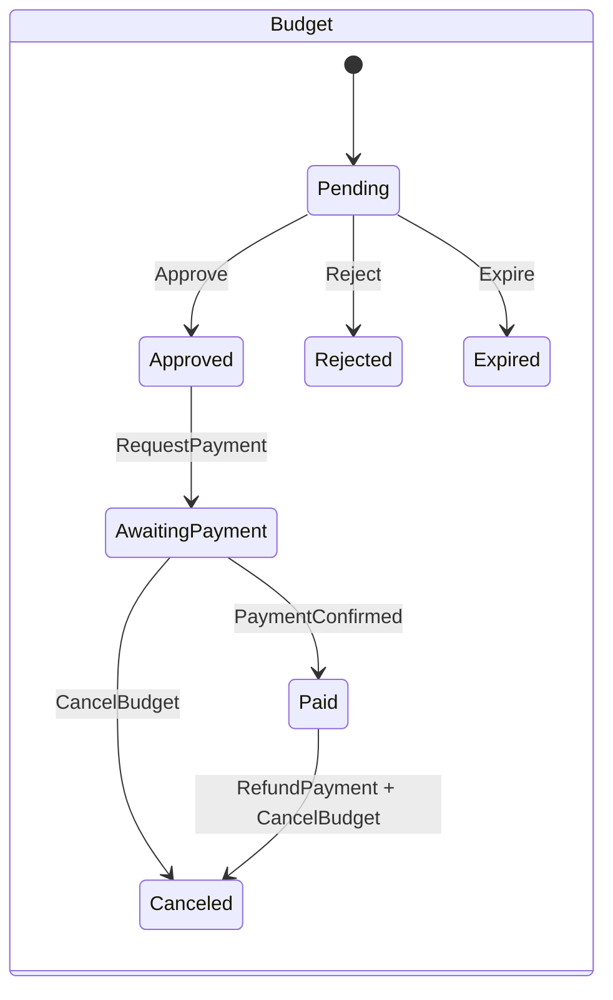
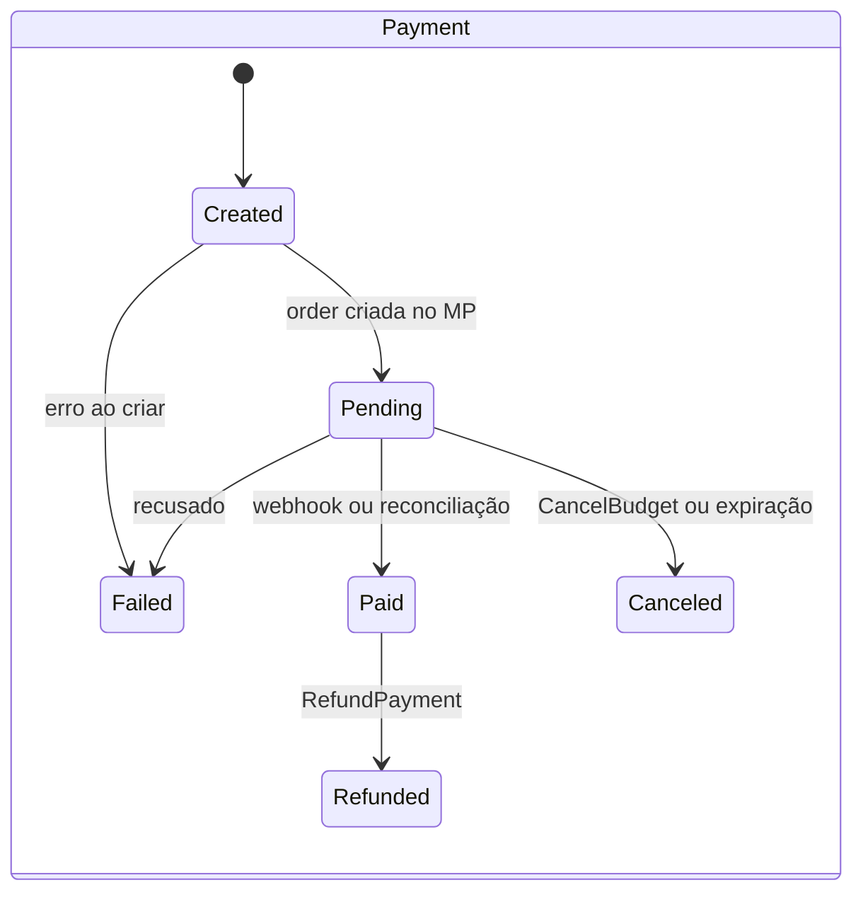
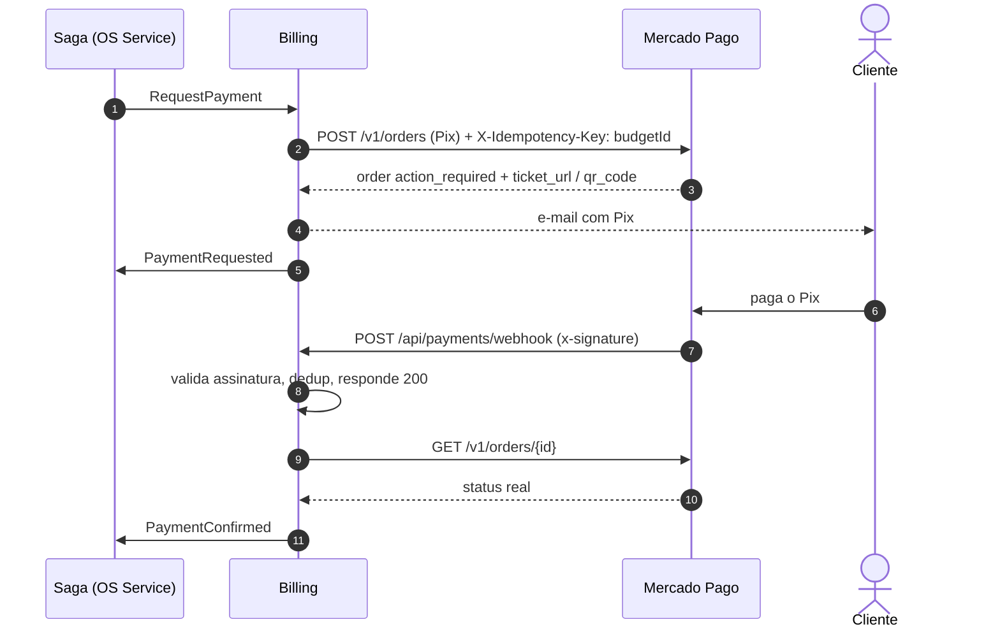
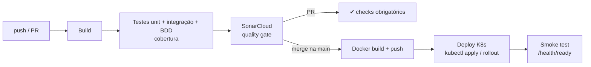

# GearFlow Billing Service

Microsserviço de **Orçamento e Pagamento** do GearFlow (Tech Challenge, Fase 4, 12SOAT).

Responsável por:
- **Gerar orçamentos** a partir do diagnóstico e enviá-los ao cliente para aprovação.
- **Registrar a aprovação ou rejeição** do orçamento (por link de e-mail ou pela API).
- **Cobrar via Mercado Pago** (Pix pela Orders API), receber o **webhook** e verificar o pagamento.
- **Avisar a Saga** (OS Service) sobre o resultado, para que o status da OS seja atualizado após o pagamento.
- **Executar compensações**: cancelar o orçamento e cancelar ou reembolsar o pagamento.

> Este serviço é **participante** de uma **Saga orquestrada**. O orquestrador fica no `gearflow-os-service`. O Billing nunca decide o próximo passo do fluxo: ele executa comandos e responde com eventos.

---

## Sumário
1. [Visão geral da arquitetura](#1-visão-geral-da-arquitetura)
2. [Papel na Saga](#2-papel-na-saga)
3. [Tecnologias](#3-tecnologias)
4. [Estrutura da solution e das pastas](#4-estrutura-da-solution-e-das-pastas)
5. [Camadas e responsabilidades](#5-camadas-e-responsabilidades)
6. [Modelo de domínio](#6-modelo-de-domínio)
7. [Banco de dados (MongoDB)](#7-banco-de-dados-mongodb)
8. [Mensageria (RabbitMQ + MassTransit)](#8-mensageria-rabbitmq--masstransit)
9. [Integração com o Mercado Pago](#9-integração-com-o-mercado-pago)
10. [API REST](#10-api-rest)
11. [Configuração](#11-configuração)
12. [Como rodar localmente](#12-como-rodar-localmente)
13. [Testes e cobertura](#13-testes-e-cobertura)
14. [CI/CD](#14-cicd)
15. [Kubernetes](#15-kubernetes)
16. [Observabilidade](#16-observabilidade)
17. [Origem no legado](#17-origem-no-legado)
18. [Decisões de arquitetura (ADRs)](#18-decisões-de-arquitetura-adrs)

---

## 1. Visão geral da arquitetura



**Regras de fronteira**
- O Billing **só** acessa o próprio banco (MongoDB). Nunca lê o banco da OS ou do Execution.
- Os dados do cliente (nome e e-mail) e os itens com preço **chegam nas mensagens** e ficam como snapshot no documento do orçamento.
- Toda comunicação com outros serviços passa pelo **RabbitMQ**. O REST é só para o front, para o link do cliente e para o webhook do Mercado Pago.

---

## 2. Papel na Saga

| # | Comando recebido (do orquestrador) | Ação local | Sucesso | Falha | Compensação |
|---|---|---|---|---|---|
| 3 | `GenerateBudget` | Cria o `Budget` [Pending] e envia o e-mail com os links | `BudgetGenerated` | `BudgetGenerationFailed` | `CancelBudget` |
| 4 | *(ação do cliente)* | Aprova ou rejeita pelo link | `BudgetApproved` | `BudgetRejected` | `CancelBudget` |
| 5 | `RequestPayment` | Cria o `Payment` e a order Pix no MP, e envia o e-mail com o Pix | `PaymentRequested` → `PaymentConfirmed` | `PaymentFailed` | `RefundPayment` / cancelar order |

Comandos de compensação que o serviço trata:
- `CancelBudget` → orçamento `Canceled`/`Expired`. Se existir uma order pendente no MP, ela é **cancelada**. Responde `BudgetCanceled`.
- `RefundPayment` → **reembolso** da order no MP, pagamento `Refunded`, e-mail ao cliente. Responde `PaymentRefunded`.

**Garantias**
- **Transação local + Outbox (MassTransit/MongoDB):** o documento e as mensagens são gravados juntos, então nunca acontece de "salvar e não publicar".
- **Idempotência:**
  - Inbox do MassTransit, que deduplica por `MessageId`.
  - Índices únicos (`serviceOrderId` no orçamento, `budgetId` no pagamento).
  - `X-Idempotency-Key = BudgetId` nas chamadas ao MP.
- **Compensações idempotentes:** compensar algo que já foi compensado, ou que nunca aconteceu, responde sucesso e não lança erro.
- **Correlação:** `CorrelationId = ServiceOrderId` em todas as mensagens.

O fluxo completo, com os diagramas de sequência e os cenários de falha, está em [`docs/fluxo-saga.md`](docs/fluxo-saga.md).

---

## 3. Tecnologias

| Item | Escolha | Motivo |
|---|---|---|
| Runtime | **.NET 8** / ASP.NET Core | Mesma stack do legado, código reaproveitado |
| Banco | **MongoDB 7** (replica set) | Requisito de NoSQL. O orçamento é um documento com itens embutidos, e o payload do MP é semiestruturado |
| Driver | `MongoDB.Driver` | Oficial |
| Mensageria | **RabbitMQ** + **MassTransit 8** | Consumers, retry, DLQ, Outbox/Inbox no Mongo |
| Pagamento | **Mercado Pago Orders API** (`/v1/orders`) via `HttpClient` tipado | Integração Pix atual do MP |
| Resiliência | **Polly** (`Microsoft.Extensions.Http.Resilience`) | Retry, timeout e circuit breaker nas chamadas ao MP |
| Validação | FluentValidation | Igual ao legado |
| E-mail | SMTP (Mailpit em dev) | Igual ao legado |
| Docs da API | Swagger (Swashbuckle) + collection Postman | Entregável do PDF |
| Observabilidade | **OpenTelemetry** (traces, métricas, logs) | Rastreio ponta a ponta da Saga |
| Testes | xUnit, Moq, FluentAssertions, **Testcontainers**, **WireMock.Net**, MassTransit Test Harness, **Reqnroll** (BDD), coverlet | Unitários, integração e BDD |
| Qualidade | **SonarCloud** | Quality gate no CI |
| Deploy | Docker + **Kubernetes** + GitHub Actions | Requisito do PDF |

---

## 4. Estrutura da solution e das pastas

```
gearflow-budget-service/
├── .github/
│   ├── workflows/
│   │   └── ci-cd.yml                       # build → test → sonar → docker → deploy k8s
│   ├── pull_request_template.md
│   └── CODEOWNERS
│
├── src/
│   ├── GearFlow.Billing.Api/               # Camada de entrada (HTTP)
│   │   ├── Controllers/
│   │   │   ├── BudgetsController.cs        # consulta, aprovar/rejeitar (JSON e link HTML)
│   │   │   └── PaymentsController.cs       # consulta + webhook do Mercado Pago
│   │   ├── Configurations/
│   │   │   ├── DependencyInjectionExtensions.cs
│   │   │   ├── MassTransitExtensions.cs
│   │   │   ├── MongoExtensions.cs
│   │   │   ├── OpenTelemetryExtensions.cs
│   │   │   ├── SwaggerExtensions.cs
│   │   │   ├── JwtExtensions.cs
│   │   │   └── HealthCheckExtensions.cs
│   │   ├── Filters/
│   │   │   └── CustomExceptionFilter.cs    # Domain/NotFound/Forbidden → HTTP
│   │   ├── Pages/
│   │   │   └── HtmlResultPage.cs           # página de confirmação do link de e-mail
│   │   ├── appsettings.json
│   │   ├── appsettings.Development.json
│   │   ├── Program.cs
│   │   └── Dockerfile
│   │
│   ├── GearFlow.Billing.Application/       # CQRS: Commands (escrita) e Queries (leitura)
│   │   ├── Abstractions/
│   │   │   ├── ICommand.cs                 # ICommand / ICommand<TResult>
│   │   │   ├── ICommandHandler.cs          # ICommandHandler<TCommand> / <TCommand, TResult>
│   │   │   ├── IQuery.cs                   # IQuery<TResult>
│   │   │   ├── IQueryHandler.cs            # IQueryHandler<TQuery, TResult>
│   │   │   ├── IDispatcher.cs              # Send(command) / Query(query)
│   │   │   └── Result.cs                   # Result / Result<T> (sucesso ou erro)
│   │   ├── Behaviors/                      # decorators aplicados a todo handler
│   │   │   ├── ValidationDecorator.cs      # FluentValidation antes do handler
│   │   │   └── LoggingDecorator.cs         # log + span OpenTelemetry por command
│   │   ├── Budgets/
│   │   │   ├── Commands/
│   │   │   │   ├── GenerateBudget/
│   │   │   │   │   ├── GenerateBudgetCommand.cs
│   │   │   │   │   ├── GenerateBudgetCommandHandler.cs
│   │   │   │   │   └── GenerateBudgetCommandValidator.cs
│   │   │   │   ├── ApproveBudget/
│   │   │   │   ├── RejectBudget/
│   │   │   │   └── CancelBudget/           # compensação
│   │   │   └── Queries/
│   │   │       ├── GetBudgetById/
│   │   │       │   ├── GetBudgetByIdQuery.cs
│   │   │       │   ├── GetBudgetByIdQueryHandler.cs
│   │   │       │   └── BudgetDetailsDto.cs
│   │   │       └── GetBudgetByServiceOrder/
│   │   ├── Payments/
│   │   │   ├── Commands/
│   │   │   │   ├── RequestPayment/
│   │   │   │   ├── ProcessPaymentWebhook/
│   │   │   │   ├── RefundPayment/          # compensação
│   │   │   │   └── ReconcilePayments/
│   │   │   └── Queries/
│   │   │       ├── GetPaymentById/
│   │   │       └── GetPaymentByBudget/
│   │   ├── Consumers/                      # Comandos da Saga (MassTransit) → Dispatcher
│   │   │   ├── GenerateBudgetConsumer.cs
│   │   │   ├── RequestPaymentConsumer.cs
│   │   │   ├── CancelBudgetConsumer.cs
│   │   │   └── RefundPaymentConsumer.cs
│   │   ├── Notifications/
│   │   │   ├── BudgetEmailTemplates.cs     # HTML vindo do BudgetGeneratedEmailHandler legado
│   │   │   ├── PaymentEmailTemplates.cs
│   │   │   └── NotificationService.cs
│   │   └── Interfaces/
│   │       ├── IPaymentGateway.cs
│   │       ├── IEmailSender.cs
│   │       ├── IApprovalTokenService.cs    # token assinado nos links de aprovação
│   │       └── IClock.cs
│   │
│   ├── GearFlow.Billing.Domain/            # Regras de negócio puras (sem dependências)
│   │   ├── Core/
│   │   │   ├── Entity.cs
│   │   │   ├── IAggregateRoot.cs
│   │   │   ├── ValueObject.cs
│   │   │   └── DomainException.cs
│   │   ├── Budgets/
│   │   │   ├── Budget.cs                   # aggregate root
│   │   │   ├── BudgetItem.cs               # serviço | peça | insumo (snapshot de preço)
│   │   │   ├── BudgetItemType.cs
│   │   │   ├── BudgetStatus.cs
│   │   │   └── Customer.cs                 # value object (nome, e-mail)
│   │   ├── Payments/
│   │   │   ├── Payment.cs                  # aggregate root
│   │   │   ├── PaymentStatus.cs
│   │   │   └── PaymentAttempt.cs           # histórico de chamadas e webhooks
│   │   ├── Notifications/
│   │   │   └── Notification.cs
│   │   ├── Exceptions/
│   │   │   ├── NotFoundException.cs
│   │   │   └── ForbiddenException.cs
│   │   └── Repositories/
│   │       ├── IBudgetRepository.cs
│   │       ├── IPaymentRepository.cs
│   │       └── INotificationRepository.cs
│   │
│   └── GearFlow.Billing.Infrastructure/    # Detalhes técnicos
│       ├── Dispatching/
│       │   └── Dispatcher.cs               # resolve o handler no DI (sem MediatR)
│       ├── Persistence/
│       │   ├── MongoContext.cs
│       │   ├── ReadModels/                 # projeções Mongo usadas pelos Query Handlers
│       │   ├── MongoClassMaps.cs           # mapeamento sem atributos no domínio
│       │   ├── MongoIndexes.cs             # criação de índices no startup
│       │   └── Repositories/
│       │       ├── BudgetRepository.cs
│       │       ├── PaymentRepository.cs
│       │       └── NotificationRepository.cs
│       ├── Messaging/
│       │   └── MassTransitConfiguration.cs # RabbitMQ, retry, DLQ, Mongo Outbox/Inbox
│       ├── PaymentGateway/
│       │   └── MercadoPago/
│       │       ├── MercadoPagoGateway.cs   # implementa IPaymentGateway
│       │       ├── MercadoPagoOptions.cs
│       │       ├── MercadoPagoSignatureValidator.cs
│       │       └── Models/                 # CreateOrderRequest, OrderResponse...
│       ├── Email/
│       │   └── SmtpEmailSender.cs
│       ├── Security/
│       │   └── HmacApprovalTokenService.cs
│       └── BackgroundJobs/
│           └── PaymentReconciliationJob.cs # BackgroundService
│
├── tests/
│   ├── GearFlow.Billing.UnitTests/
│   │   ├── Domain/                         # Budget, Payment: transições de status
│   │   ├── Application/                    # command/query handlers e consumers (MassTransit Harness)
│   │   ├── Api/                            # controllers e filtro de exceção
│   │   └── Infrastructure/                 # signature validator, token service
│   ├── GearFlow.Billing.IntegrationTests/
│   │   ├── Fixtures/                       # Testcontainers (Mongo, RabbitMQ), WireMock (MP)
│   │   ├── Persistence/
│   │   ├── Messaging/
│   │   └── MercadoPago/
│   └── GearFlow.Billing.BddTests/
│       ├── Features/
│       │   ├── AprovacaoDeOrcamento.feature
│       │   └── PagamentoViaPix.feature
│       └── StepDefinitions/
│
├── k8s/
│   ├── namespace.yaml
│   ├── configmap.yaml
│   ├── secret.example.yaml                 # modelo. O secret real vem do CI
│   ├── deployment.yaml
│   ├── service.yaml
│   ├── hpa.yaml
│   ├── ingress.yaml                        # expõe /api/budgets e /api/payments/webhook
│   └── mongodb/
│       ├── statefulset.yaml                # replica set de 1 nó (rs0)
│       ├── service.yaml
│       └── init-replicaset-job.yaml
│
├── docs/
│   ├── fluxo-saga.md                       # diagramas completos da Saga
│   ├── adr/
│   │   ├── 0001-mongodb-como-banco.md
│   │   ├── 0002-saga-orquestrada.md
│   │   └── 0003-mercado-pago-orders-api.md
│   ├── coverage/                           # prints de cobertura e do Sonar
│   └── postman/
│       └── gearflow-billing.postman_collection.json
│
├── docker-compose.yml                      # mongo (rs), rabbitmq, mailpit, wiremock
├── GearFlow.Billing.slnx
├── Directory.Build.props                   # versão do .NET, nullable, analyzers
├── Directory.Packages.props                # versões centralizadas dos pacotes
├── coverlet.runsettings                    # exclusões de cobertura
├── .editorconfig
├── .dockerignore
├── .gitignore
└── README.md
```

### Projetos da solution e dependências



- **Domain** não referencia nada. É C# puro.
- **Application** depende só do Domain, de abstrações e do `GearFlow.Contracts` (mensagens da Saga, publicado no GitHub Packages e compartilhado pelos 3 serviços).
- **Infrastructure** implementa as interfaces da Application (Mongo, MP, SMTP, MassTransit).
- **Api** é o *composition root*: faz o DI e expõe o HTTP.

---

## 5. Camadas e responsabilidades

| Camada | Pode | Não pode |
|---|---|---|
| **Domain** | Regras e invariantes (ex.: "orçamento já revisado não pode ser aprovado de novo"), transições de status, cálculo do total | Conhecer Mongo, HTTP, RabbitMQ ou o MP |
| **Application** | Command Handlers (carregar o agregado, chamar o domínio, salvar, publicar evento, chamar `IPaymentGateway`) e Query Handlers (ler e devolver DTO) | Ter regra de negócio que pertence à entidade |
| **Infrastructure** | Detalhes técnicos, integrações externas, Dispatcher, read models | Decidir regra de negócio |
| **Api** | Receber HTTP, autenticar, montar o Command/Query e enviar ao `IDispatcher`, traduzir exceções | Acessar repositório ou handler diretamente |

### 5.1 CQRS com Command Handlers

A Application segue **CQRS**: o lado de escrita (Commands) e o lado de leitura (Queries) são separados.

| | **Command** (escrita) | **Query** (leitura) |
|---|---|---|
| Intenção | Mudar estado ("aprove este orçamento") | Ler estado ("me mostre o orçamento") |
| Passa pelo domínio? | **Sim.** Carrega o agregado, chama o método da entidade e salva | **Não.** Lê direto do Mongo com projeção para DTO |
| Repositório | `IBudgetRepository` / `IPaymentRepository` (agregado inteiro) | `IBudgetReadModel` / `IPaymentReadModel` (projeção) |
| Publica evento? | Sim, pelo Outbox | Nunca |
| Retorno | `Result` / `Result<Guid>` (o mínimo) | DTO pronto para a tela/API |
| Validação | `ValidationDecorator` (FluentValidation) | Opcional |

**Quem dispara os commands.** O mesmo handler atende os dois lados:



**Commands e Queries do Billing**

| Tipo | Nome | Disparado por | Publica |
|---|---|---|---|
| Command | `GenerateBudgetCommand` | Consumer `GenerateBudget` (Saga) | `BudgetGenerated` |
| Command | `ApproveBudgetCommand` | Controller (link/API) | `BudgetApproved` |
| Command | `RejectBudgetCommand` | Controller (link/API) | `BudgetRejected` |
| Command | `CancelBudgetCommand` | Consumer `CancelBudget` (compensação) | `BudgetCanceled` |
| Command | `RequestPaymentCommand` | Consumer `RequestPayment` (Saga) | `PaymentRequested` |
| Command | `ProcessPaymentWebhookCommand` | Controller (webhook MP) | `PaymentConfirmed` / `PaymentFailed` |
| Command | `RefundPaymentCommand` | Consumer `RefundPayment` (compensação) | `PaymentRefunded` |
| Command | `ReconcilePaymentsCommand` | `PaymentReconciliationJob` | `PaymentConfirmed` / `PaymentFailed` |
| Query | `GetBudgetByIdQuery` | Controller | — |
| Query | `GetBudgetByServiceOrderQuery` | Controller | — |
| Query | `GetPaymentByIdQuery` | Controller | — |
| Query | `GetPaymentByBudgetQuery` | Controller | — |

**Abstrações (sem MediatR)**

```csharp
public interface ICommand<TResult> { }
public interface ICommandHandler<in TCommand, TResult> where TCommand : ICommand<TResult>
{
    Task<TResult> HandleAsync(TCommand command, CancellationToken ct);
}

public interface IQuery<TResult> { }
public interface IQueryHandler<in TQuery, TResult> where TQuery : IQuery<TResult>
{
    Task<TResult> HandleAsync(TQuery query, CancellationToken ct);
}

public interface IDispatcher
{
    Task<TResult> Send<TResult>(ICommand<TResult> command, CancellationToken ct = default);
    Task<TResult> Query<TResult>(IQuery<TResult> query, CancellationToken ct = default);
}
```

**Exemplo: aprovar orçamento**

```csharp
public sealed record ApproveBudgetCommand(Guid BudgetId, string ApprovalToken) : ICommand<Result>;

public sealed class ApproveBudgetCommandHandler(
    IBudgetRepository budgets,
    IApprovalTokenService tokens,
    IPublishEndpoint publisher)               // Outbox do MassTransit
    : ICommandHandler<ApproveBudgetCommand, Result>
{
    public async Task<Result> HandleAsync(ApproveBudgetCommand cmd, CancellationToken ct)
    {
        var budget = await budgets.GetAsync(cmd.BudgetId, ct)
            ?? throw new NotFoundException($"Orçamento '{cmd.BudgetId}' não encontrado.");

        if (!tokens.IsValid(cmd.ApprovalToken, budget.Id))
            throw new ForbiddenException("Link de aprovação inválido ou expirado.");

        budget.Approve();                                   // regra no domínio

        await budgets.UpdateAsync(budget, ct);
        await publisher.Publish(new BudgetApproved(budget.ServiceOrderId, budget.Id, budget.TotalAmount), ct);
        return Result.Success();                            // grava + publica atomicamente (Outbox)
    }
}
```

```csharp
// Controller: só monta o command e despacha
[HttpGet("{id}/approve")]
[AllowAnonymous]
public async Task<IActionResult> ApproveByLink(Guid id, [FromQuery] string token, CancellationToken ct)
{
    await _dispatcher.Send(new ApproveBudgetCommand(id, token), ct);
    return HtmlResultPage.Approved(id);
}

// Consumer da Saga: mesma ideia
public sealed class GenerateBudgetConsumer(IDispatcher dispatcher) : IConsumer<GenerateBudget>
{
    public Task Consume(ConsumeContext<GenerateBudget> ctx) =>
        dispatcher.Send(GenerateBudgetCommand.From(ctx.Message), ctx.CancellationToken);
}
```

**Por que um Dispatcher próprio e não MediatR:** são cerca de 40 linhas de código, sem dependência extra. As versões novas do MediatR passaram a ter licença comercial. Os handlers são registrados por varredura do assembly no DI, e os decorators (validação e log) são aplicados a todos os handlers. Se o time preferir, dá para trocar pelo **MassTransit Mediator**, que já é dependência do projeto.

**Testes:** cada handler é testado isoladamente, com mock do repositório, do gateway e do publisher. Os consumers e controllers só precisam de um teste simples de "despachou o command certo".

---

## 6. Modelo de domínio



### Estados





---

## 7. Banco de dados (MongoDB)

Database: `gearflow_billing`

| Collection | Conteúdo | Índices |
|---|---|---|
| `budgets` | Orçamento com itens e cliente embutidos | `serviceOrderId` (único), `status`, `expiresOn` |
| `payments` | Pagamento, dados do MP e tentativas | `budgetId` (único), `mercadoPagoOrderId` (único, sparse), `status + createdOn` (reconciliação) |
| `notifications` | E-mails enviados (histórico) | `serviceOrderId`, `sentOn` |
| `processed_webhooks` | Dedup de webhooks do MP | `notificationId` (único), TTL de 30 dias |
| `outbox_*` / `inbox_*` | Outbox e Inbox do MassTransit | gerenciado pelo MassTransit |

Exemplo de documento `budgets`:
```json
{
  "_id": "3f1c...",
  "serviceOrderId": "9a7e...",
  "customer": { "name": "Maria Silva", "email": "maria@email.com" },
  "items": [
    { "referenceId": "b1..", "type": "Job",        "description": "Troca de óleo", "unitPrice": 120.00, "quantity": 1, "subtotal": 120.00 },
    { "referenceId": "c2..", "type": "Part",       "description": "Filtro de óleo", "unitPrice": 45.00,  "quantity": 1, "subtotal": 45.00 },
    { "referenceId": "d3..", "type": "Consumable", "description": "Óleo 5W30 (L)",  "unitPrice": 37.00,  "quantity": 5, "subtotal": 185.00 }
  ],
  "totalAmount": 350.00,
  "status": "AwaitingPayment",
  "createdOn": "2026-11-03T13:00:00Z",
  "reviewedOn": "2026-11-03T14:10:00Z",
  "expiresOn": "2026-11-05T13:00:00Z"
}
```

> ⚠️ O MongoDB precisa rodar como **replica set** (mesmo com 1 nó). Sem isso não há transações, e o Outbox do MassTransit depende delas.

---

## 8. Mensageria (RabbitMQ + MassTransit)

| Direção | Mensagem | Fila / Exchange |
|---|---|---|
| ⬇ consome | `GenerateBudget` | `billing-generate-budget` |
| ⬇ consome | `RequestPayment` | `billing-request-payment` |
| ⬇ consome | `CancelBudget` | `billing-cancel-budget` |
| ⬇ consome | `RefundPayment` | `billing-refund-payment` |
| ⬆ publica | `BudgetGenerated`, `BudgetGenerationFailed`, `BudgetApproved`, `BudgetRejected`, `BudgetCanceled` | exchange do tipo (fanout do MassTransit) |
| ⬆ publica | `PaymentRequested`, `PaymentConfirmed`, `PaymentFailed`, `PaymentRefunded` | exchange do tipo |

**Políticas**
- Retry: 3 tentativas com intervalo exponencial (1s, 5s, 15s). Depois disso a mensagem vai para a fila `*_error` (DLQ).
- Outbox e Inbox do MassTransit no MongoDB.
- Todas as mensagens vêm do pacote `GearFlow.Contracts` e carregam `CorrelationId` = `ServiceOrderId`.

---

## 9. Integração com o Mercado Pago



| Operação | Endpoint MP | Uso |
|---|---|---|
| Criar cobrança Pix | `POST /v1/orders` | `RequestPayment` |
| Consultar | `GET /v1/orders/{id}` | webhook e reconciliação |
| Cancelar order pendente | cancelamento de order (ver doc "Reembolsos e cancelamentos") | `CancelBudget` |
| Reembolsar | reembolso de order (ver doc "Reembolsos e cancelamentos") | `RefundPayment` |

**Regras**
- Credenciais **de teste** (`APP_USR-...`) em dev e na demo. Ficam em Secret do K8s e nunca no repositório.
- **Webhook**:
  1. Valida o `x-signature` (HMAC com o secret do painel).
  2. Responde 200 em menos de 22s.
  3. **Sempre consulta o status real** na API. O corpo da notificação não é usado como fonte de verdade.
  4. Deduplica pelo id da notificação.
- **Reconciliação**: o `PaymentReconciliationJob` roda a cada 5 min e consulta os `Payment` em `Pending` com mais de 10 min. Cobre o caso de webhook perdido.
- **Resiliência**: timeout de 10s, 3 retries e circuit breaker. Se tudo falhar, publica `PaymentFailed` e a Saga compensa.
- Tudo fica atrás de `IPaymentGateway`. Os testes usam **WireMock** no lugar da API real.

Documentação oficial: [Pix com Orders API](https://www.mercadopago.com.br/developers/pt/docs/checkout-api-orders/payment-integration/pix) · [Webhooks](https://www.mercadopago.com.br/developers/pt/docs/your-integrations/notifications/webhooks) · [Reembolsos e cancelamentos](https://www.mercadopago.com.br/developers/pt/docs/checkout-api-orders/payment-management/refunds)

---

## 10. API REST

Swagger: `GET /swagger`

| Método | Rota | Auth | Descrição |
|---|---|---|---|
| GET | `/api/budgets/{id}` | JWT | Detalhes do orçamento |
| GET | `/api/budgets/service-order/{serviceOrderId}` | JWT | Orçamento de uma OS |
| PUT | `/api/budgets/{id}/approve` | token do link | Aprova (JSON) |
| PUT | `/api/budgets/{id}/reject` | token do link | Rejeita (JSON) |
| GET | `/api/budgets/{id}/approve?token=...` | token do link | Aprova com 1 clique (retorna HTML) |
| GET | `/api/budgets/{id}/reject?token=...` | token do link | Rejeita com 1 clique (retorna HTML) |
| GET | `/api/payments/{id}` | JWT | Detalhes do pagamento |
| GET | `/api/payments/budget/{budgetId}` | JWT | Pagamento de um orçamento (com `ticketUrl`/QR) |
| POST | `/api/payments/webhook` | `x-signature` | Webhook do Mercado Pago |
| GET | `/health/live` · `/health/ready` | — | Probes do K8s (o ready checa Mongo e RabbitMQ) |

> O link do e-mail usa um **token HMAC assinado** (`budgetId + expiração`) em vez do e-mail em texto puro na URL, como acontecia no legado.

---

## 11. Configuração

| Variável | Exemplo | Descrição |
|---|---|---|
| `ConnectionStrings__Mongo` | `mongodb://mongo:27017/?replicaSet=rs0` | MongoDB |
| `Mongo__Database` | `gearflow_billing` | Nome do database |
| `RabbitMq__Host` | `rabbitmq` | Host do broker |
| `RabbitMq__Username` / `__Password` | `guest` | Credenciais |
| `MercadoPago__BaseUrl` | `https://api.mercadopago.com` | Em teste, aponta para o WireMock |
| `MercadoPago__AccessToken` | *(secret)* | Token de teste `APP_USR-...` |
| `MercadoPago__WebhookSecret` | *(secret)* | Secret para validar o `x-signature` |
| `MercadoPago__NotificationUrl` | `https://<ingress>/api/payments/webhook` | URL pública do webhook |
| `MercadoPago__PixExpiration` | `PT30M` | Validade do Pix (ISO 8601) |
| `Billing__BudgetExpirationHours` | `48` | Prazo para o cliente aprovar |
| `Billing__PublicBaseUrl` | `https://<ingress>` | Base dos links do e-mail |
| `Billing__ApprovalTokenSecret` | *(secret)* | Chave HMAC dos links |
| `Email__Host` / `__Port` | `mailpit` / `1025` | SMTP |
| `Jwt__Authority` / `__Audience` | — | Validação de JWT (emitido pelo OS Service ou pelo Auth da Fase 3) |
| `OTEL_EXPORTER_OTLP_ENDPOINT` | `http://otel-collector:4317` | Destino dos traces |

---

## 12. Como rodar localmente

Pré-requisitos: .NET 8 SDK, Docker.

```bash
# 1. dependências (Mongo replica set, RabbitMQ, Mailpit, WireMock)
docker compose up -d

# 2. segredos locais
dotnet user-secrets --project src/GearFlow.Billing.Api set "MercadoPago:AccessToken" "APP_USR-..."
dotnet user-secrets --project src/GearFlow.Billing.Api set "MercadoPago:WebhookSecret" "..."

# 3. API
dotnet run --project src/GearFlow.Billing.Api
```

| Serviço | URL |
|---|---|
| Swagger | http://localhost:5080/swagger |
| RabbitMQ UI | http://localhost:15672 (guest/guest) |
| Mailpit (e-mails) | http://localhost:8025 |
| Mongo | mongodb://localhost:27017/?replicaSet=rs0 |

Para receber o webhook real do Mercado Pago em ambiente local, exponha a porta com `ngrok http 5080` e configure a URL gerada em `MercadoPago__NotificationUrl`.

---

## 13. Testes e cobertura

```bash
dotnet test --collect:"XPlat Code Coverage" --settings coverlet.runsettings
```

| Projeto | O que cobre | Ferramentas |
|---|---|---|
| `UnitTests` | Domínio (transições e invariantes), command/query handlers, consumers, controllers, signature validator | xUnit, Moq, FluentAssertions, MassTransit Test Harness |
| `IntegrationTests` | Repositórios no Mongo real, Outbox, gateway do MP contra WireMock (aprovado, recusado, 5xx, timeout) | Testcontainers, WireMock.Net |
| `BddTests` | Cenários de negócio em Gherkin | Reqnroll |

Exemplo de cenário BDD (`PagamentoViaPix.feature`):
```gherkin
Funcionalidade: Pagamento do orçamento via Pix
  Cenário: Cliente paga o Pix e a Saga é avisada
    Dado um orçamento aprovado de R$ 350,00 para a OS "OS-001"
    Quando a Saga solicitar o pagamento
    E o Mercado Pago confirmar o pagamento via webhook
    Então o pagamento deve ficar "Paid"
    E o evento "PaymentConfirmed" deve ser publicado para a OS "OS-001"

  Cenário: Estorno quando falta estoque após o pagamento
    Dado um pagamento "Paid" para a OS "OS-002"
    Quando a Saga solicitar o reembolso
    Então o Mercado Pago deve receber o pedido de reembolso
    E o pagamento deve ficar "Refunded"
    E o evento "PaymentRefunded" deve ser publicado
```

**Meta: ≥ 80% de cobertura** (o quality gate do Sonar bloqueia o PR abaixo disso).
Ficam fora da cobertura (`coverlet.runsettings`): `Program.cs`, `Configurations/*`, `DTOs/*` e `Models/*` do MP.

Evidências: [`docs/coverage/`](docs/coverage/) · Sonar: *link do projeto no SonarCloud*

---

## 14. CI/CD

Pipeline em `.github/workflows/ci-cd.yml`, independente dos outros serviços:



- `main` protegida: **PR obrigatório**, 1 aprovação mínima e checks obrigatórios (build, testes, Sonar).
- O deploy só roda depois do merge na `main` e com o quality gate aprovado.
- Os secrets (MP, Mongo, RabbitMQ, kubeconfig, Sonar token) ficam nos **GitHub Secrets**.

---

## 15. Kubernetes

| Recurso | Arquivo | Observação |
|---|---|---|
| Deployment | `k8s/deployment.yaml` | 2 réplicas, probes live/ready, limites de CPU e memória |
| Service | `k8s/service.yaml` | ClusterIP |
| HPA | `k8s/hpa.yaml` | 2 a 5 réplicas, CPU 70% |
| Ingress | `k8s/ingress.yaml` | expõe `/api/budgets`, `/api/payments` (inclui o webhook) |
| ConfigMap / Secret | `k8s/configmap.yaml`, `k8s/secret.example.yaml` | o secret real é criado pelo pipeline |
| MongoDB | `k8s/mongodb/*` | StatefulSet + PVC + Job que inicializa o `rs0` |

O RabbitMQ e o coletor de observabilidade são compartilhados e ficam no repositório de infraestrutura (`gearflow-infra-k8s`).

---

## 16. Observabilidade

- **Traces**: OpenTelemetry (ASP.NET Core, HttpClient, MongoDB, MassTransit). O trace atravessa o RabbitMQ, então uma OS aparece como **um único trace** passando por OS → Execution → Billing → Mercado Pago.
- **Logs** estruturados com `CorrelationId`, `BudgetId` e `PaymentId`.
- **Métricas**: orçamentos gerados, aprovados e rejeitados; pagamentos confirmados, falhos e reembolsados; tempo de aprovação; mensagens em DLQ.
- Enviados para a ferramenta de observabilidade da Fase 3.

---

## 17. Origem no legado

Código migrado de [`gearflow-legado`](https://github.com/Gearflow-Fiap/gearflow-legado):

| Legado | Aqui | Mudança |
|---|---|---|
| `Domain/Entities/BudgetAggregate/*` | `Domain/Budgets/*` | Status explícito no lugar de `bool? IsApproved`, `decimal` no lugar de `double`, itens unificados em `BudgetItem` |
| `Domain/Services/BudgetDomainService.cs` | `Application/Budgets/Commands/*` | **Não altera mais a OS nem o estoque**: publica eventos para a Saga |
| `Application/UseCases/Budget/*` (UseCase + interface) | `Application/Budgets/Commands/*` e `Queries/*` | Vira **CQRS**: Command Handlers para escrita e Query Handlers para leitura, sem acesso aos repositórios de OS e Cliente |
| `BudgetEmailValidator` | `HmacApprovalTokenService` | Link com token assinado; o cliente vem no snapshot do orçamento |
| `Api/Controllers/BudgetsController.cs` | `Api/Controllers/BudgetsController.cs` | Mantém os endpoints e as páginas HTML de clique único |
| `EventHandlers/Budget*EmailHandler.cs`, `SendEmailHandler.cs` | `Application/Notifications/*` | Disparados por consumers do RabbitMQ |
| `Domain/Entities/NotificationAggregate` | `Domain/Notifications` | Persistido no Mongo |
| `Budget.MarkJobAsExecuted` / `BudgetJob.IsExecuted` | **removido** | Acompanhar a execução passa a ser responsabilidade do Execution Service |
| `UnitTest/Domain/BudgetAggregate/*`, `BudgetServiceTests`, testes dos handlers de e-mail | `tests/GearFlow.Billing.UnitTests` | Adaptados ao novo modelo |
| *(não existia)* | `Payments/*`, `PaymentGateway/MercadoPago/*` | **Novo**: integração com o Mercado Pago |

---

## 18. Decisões de arquitetura (ADRs)

| ADR | Decisão | Resumo |
|---|---|---|
| [0001](docs/adr/0001-mongodb-como-banco.md) | MongoDB | Orçamento é um agregado lido e gravado inteiro, com itens embutidos. Payloads do MP são semiestruturados. Atende ao requisito de NoSQL |
| [0002](docs/adr/0002-saga-orquestrada.md) | Saga orquestrada (orquestrador no OS Service) | Fluxo longo com várias compensações. Estado centralizado fica mais fácil de depurar e demonstrar com um time pequeno |
| [0003](docs/adr/0003-mercado-pago-orders-api.md) | Mercado Pago Orders API (Pix) | Integração atual recomendada pelo MP. Webhook + reconciliação para resiliência |
| — | CQRS com Command/Query Handlers e Dispatcher próprio | Separa escrita (domínio + Outbox) de leitura (projeção). O mesmo handler atende HTTP, Saga e jobs. Sem dependência de MediatR |
| — | Pagamento **antes** da reserva de estoque | Garante o cenário de compensação com reembolso (a confirmar com o time) |
| — | Preços chegam no `DiagnosticFinished` | Billing sem dependência síncrona do Execution (a confirmar com o time) |

---

**Time GearFlow, 12SOAT, Fase 4.** Responsável pelo Billing: *(seu nome)*
