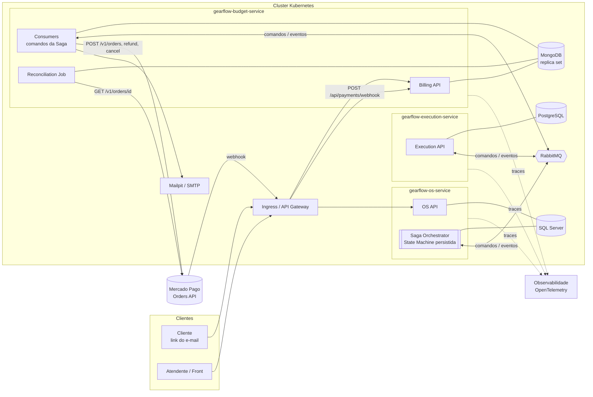
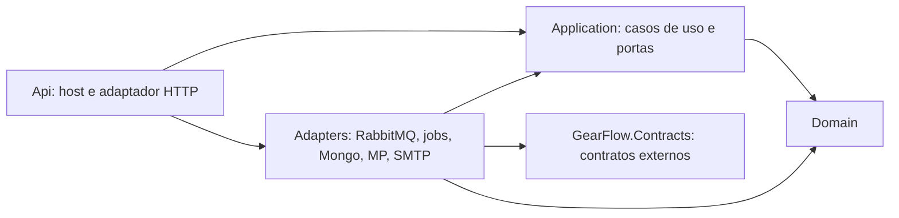
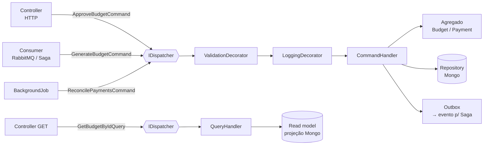
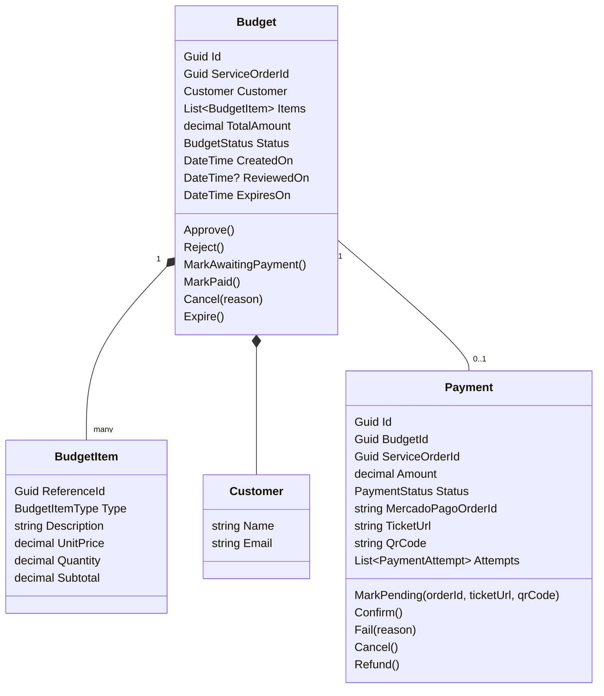
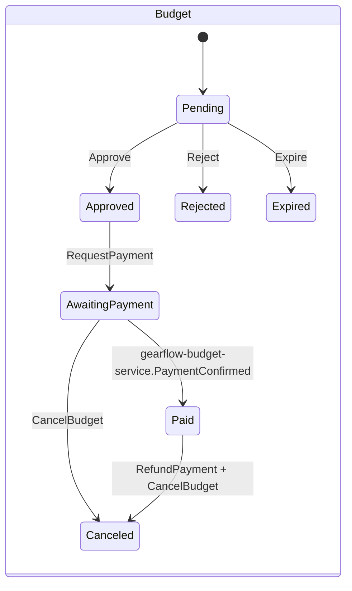
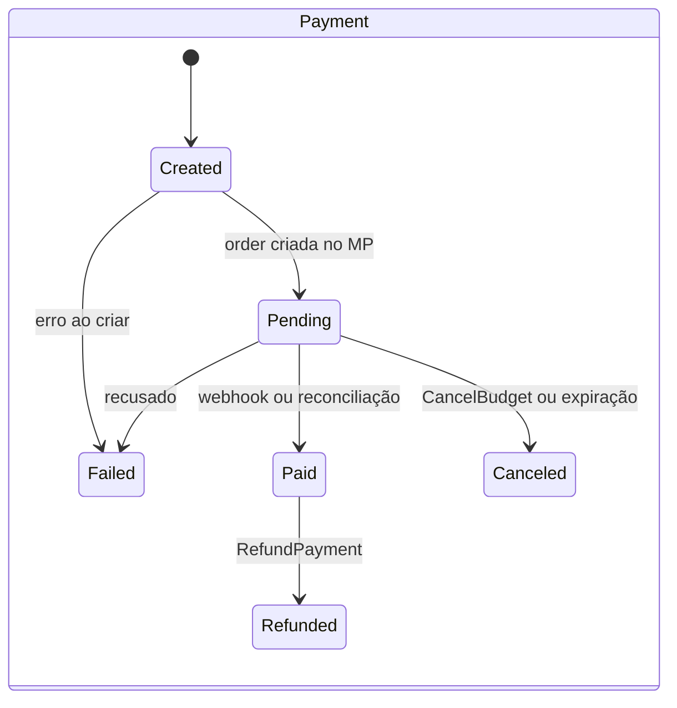
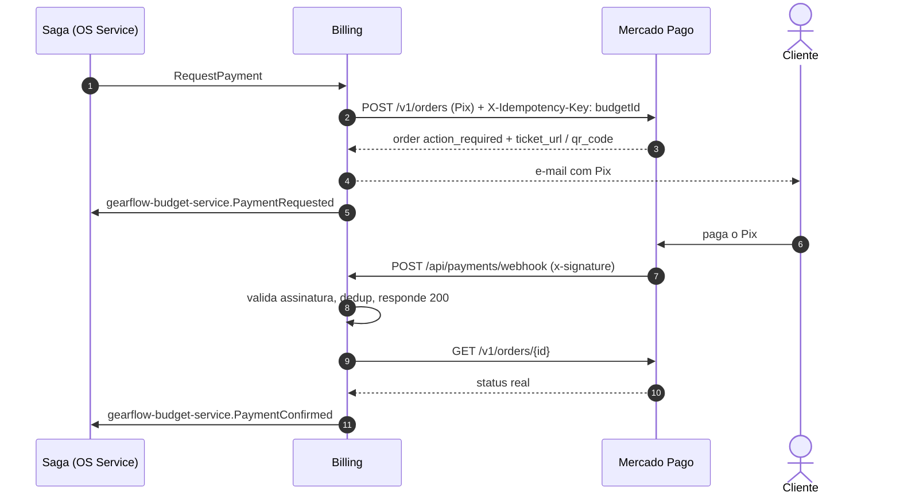
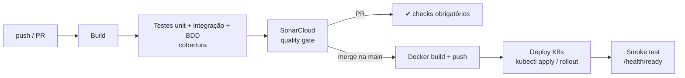

> Fluxo atual: pagamento simulado com `MercadoPago__UseMock=true` (padrão no Compose e no ConfigMap Kubernetes). Ao receber RequestPayment, o gateway retorna Paid imediatamente; Billing persiste Payment/Budget e publica PaymentRequested e PaymentConfirmed pelo Outbox. Não chama a API Mercado Pago, não exige credenciais/webhook e não gera Pix real. RefundPayment também retorna sucesso simulado; cobrança já paga exige reembolso antes do cancelamento. Mongo, RabbitMQ, aprovação e demais regras continuam ativos. Para execução direta, definir também MercadoPago__Enabled=true e a configuração normal de persistência. Para retomar a integração HTTP, definir MercadoPago__UseMock=false e configurar o provedor conforme os guias anteriores. Evidências sandbox abaixo são históricas e não são pré-requisito do fluxo simulado.

# GearFlow Billing Service

Deploy econômico no cluster EKS `gearflow`: [guia AWS Academy](docs/deploy-academy.md).

**Comece pelo [guia do fluxo completo](docs/README.md):** responsabilidades dos módulos, orçamento, aprovação, Pix/Mercado Pago, mensagens RabbitMQ, execução e compensações.

> Estado: implementação local inclui Rabbit/Inbox/Outbox, SMTP, API/JWT, Pix/webhook/reconciliação, OTEL e arquivos CI/CD/Kubernetes. **150 testes locais aprovados; Pix sandbox de R$ 50 confirmado em teste remoto separado, sem webhook.** Homologação entre serviços, webhook/refund MP e deploy continuam pendentes. [Teste MP local](docs/mercado-pago-local.md). Veja [estado executável](docs/estado-implementacao.md), [contratos entre serviços](docs/integracao-servicos.md) e [operação](docs/operacao.md). As seções arquiteturais abaixo incluem decisões alvo ainda dependentes de alinhamento externo.

**Requisito obrigatório: Domain-Driven Design (DDD) estratégico e tático**, em conjunto com arquitetura hexagonal e CQRS. Implementações e PRs devem seguir o [ADR 0005](docs/adr/0005-domain-driven-design.md), o [modelo de domínio e linguagem ubíqua](docs/modelo-dominio.md) e os critérios de aceite do [plano de implementação](docs/plano-implementacao.md). Instruções para agentes estão em [AGENTS.md](AGENTS.md).

Microsserviço de **Orçamento e Pagamento** do GearFlow (Tech Challenge, Fase 4, 12SOAT).

Responsável por:
- **Gerar orçamentos** a partir do diagnóstico e enviá-los ao cliente para aprovação.
- **Registrar a aprovação ou rejeição** do orçamento (por link de e-mail ou pela API).
- **Cobrar via Mercado Pago** (Pix pela Orders API), receber o **webhook** e verificar o pagamento.
- **Avisar a Saga** (OS Service) sobre o resultado, para que o status da OS seja atualizado após o pagamento.
- **Executar compensações**: cancelar o orçamento e cancelar ou reembolsar o pagamento.

> Este serviço é **participante** de uma **Saga orquestrada**. O orquestrador fica no `gearflow-os-service`. O Billing nunca decide o próximo passo do fluxo: ele executa comandos e responde com eventos.

---

## Sumário
1. [Visão geral da arquitetura](#1-visão-geral-da-arquitetura)
2. [Papel na Saga](#2-papel-na-saga)
3. [Tecnologias](#3-tecnologias)
4. [Estrutura da solution e das pastas](#4-estrutura-da-solution-e-das-pastas)
5. [Ports and Adapters](#5-ports-and-adapters-arquitetura-hexagonal)
6. [Modelo de domínio](#6-modelo-de-domínio)
7. [Banco de dados (MongoDB)](#7-banco-de-dados-mongodb)
8. [Mensageria (RabbitMQ + RabbitMQ.Client)](#8-mensageria-rabbitmq--rabbitmqclient)
9. [Integração com o Mercado Pago](#9-integração-com-o-mercado-pago)
10. [API REST](#10-api-rest)
11. [Configuração](#11-configuração)
12. [Como rodar localmente](#12-como-rodar-localmente)
13. [Testes e cobertura](#13-testes-e-cobertura)
14. [CI/CD](#14-cicd)
15. [Kubernetes](#15-kubernetes)
16. [Observabilidade](#16-observabilidade)
17. [Origem no legado](#17-origem-no-legado)
18. [Decisões de arquitetura (ADRs)](#18-decisões-de-arquitetura-adrs)

---

## 1. Visão geral da arquitetura



**Regras de fronteira**
- O Billing **só** acessa o próprio banco (MongoDB). Nunca lê o banco da OS ou do Execution.
- Os dados do cliente (nome e e-mail) e os itens com preço **chegam nas mensagens** e ficam como snapshot no documento do orçamento.
- Toda comunicação com outros serviços passa pelo **RabbitMQ**. O REST é só para o front, para o link do cliente e para o webhook do Mercado Pago.

---

## 2. Papel na Saga

| # | Comando recebido (do orquestrador) | Ação local | Sucesso | Falha | Compensação |
|---|---|---|---|---|---|
| 3 | `GenerateBudget` | Cria o `Budget` [Pending] e envia o e-mail com os links | `gearflow-budget-service.BudgetGenerated` | `gearflow-budget-service.BudgetGenerationFailed` | `CancelBudget` |
| 4 | *(ação do cliente)* | Aprova ou rejeita pelo link | `gearflow-budget-service.BudgetApproved` | `gearflow-budget-service.BudgetRejected` | `CancelBudget` |
| 5 | `RequestPayment` | Cria o `Payment` e a order Pix no MP, e envia o e-mail com o Pix | `gearflow-budget-service.PaymentRequested` → `gearflow-budget-service.PaymentConfirmed` | `gearflow-budget-service.PaymentFailed` | `RefundPayment` / cancelar order |

Comandos de compensação que o serviço trata:
- `CancelBudget` → orçamento `Canceled`/`Expired`. Se existir uma order pendente no MP, ela é **cancelada**. Responde `gearflow-budget-service.BudgetCanceled`.
- `RefundPayment` → **reembolso** da order no MP, pagamento `Refunded`, e-mail ao cliente. Responde `gearflow-budget-service.PaymentRefunded`.

**Garantias**
- **Transação local + Outbox (transacional no MongoDB):** o documento e as mensagens são gravados juntos, então nunca acontece de "salvar e não publicar".
- **Idempotência:**
  - Inbox da aplicação, que deduplica por `MessageId`.
  - Índices únicos (`serviceOrderId` no orçamento, `budgetId` no pagamento).
  - `X-Idempotency-Key = OperationId` persistido e distinto por criação, cancelamento e reembolso; mesma intenção reutiliza a mesma chave/corpo.
- **Compensações idempotentes:** compensar algo que já foi compensado, ou que nunca aconteceu, responde sucesso e não lança erro.
- **Correlação:** `CorrelationId = ServiceOrderId` em todas as mensagens.

O fluxo completo, com os diagramas de sequência e os cenários de falha, está em [`docs/fluxo-saga.md`](docs/fluxo-saga.md).

---

## 3. Tecnologias

| Item | Escolha | Motivo |
|---|---|---|
| Runtime | **.NET 10 LTS** / ASP.NET Core | Atualização validada no ADR 0009 |
| Banco | **MongoDB 7** (replica set) | Requisito de NoSQL. O orçamento é um documento com itens embutidos, e o payload do MP é semiestruturado |
| Driver | `MongoDB.Driver` | Oficial |
| Mensageria | **RabbitMQ** + **RabbitMQ.Client** | Consumers, retry, DLQ, Outbox/Inbox no Mongo |
| Pagamento | **Mercado Pago Orders API** (`/v1/orders`) via `HttpClient` tipado | Integração Pix atual do MP |
| Resiliência | **Polly** (`Microsoft.Extensions.Http.Resilience`) | Retry, timeout e circuit breaker nas chamadas ao MP |
| Validação | FluentValidation | Igual ao legado |
| E-mail | SMTP (Mailpit em dev) | Igual ao legado |
| Docs da API | Swagger (Swashbuckle) + collection Postman | Entregável do PDF |
| Observabilidade | **OpenTelemetry** (traces, métricas, logs) | Rastreio ponta a ponta da Saga |
| Testes | xUnit, Moq, FluentAssertions, **Testcontainers**, **WireMock.Net**, RabbitMQ com Testcontainers, **Reqnroll** (BDD), coverlet | Unitários, integração e BDD |
| Qualidade | **SonarCloud** | Quality gate no CI |
| Deploy | Docker + **Kubernetes** + GitHub Actions | Requisito do PDF |

---

## 4. Estrutura da solution e das pastas

Estrutura planejada para **Ports and Adapters (arquitetura hexagonal)**. O núcleo é formado por Domain + Application. A API é o host e composition root; o projeto Adapters reúne os adaptadores de entrada RabbitMQ/jobs e de saída. Manter projetos separados por tecnologia é opcional; a direção das dependências é obrigatória.

```text
gearflow-budget-service/
├── src/
│   ├── GearFlow.Billing.Domain/             # Núcleo de negócio, C# puro
│   │   ├── Core/                          # Entity, ValueObject, DomainException
│   │   ├── Budgets/                       # Budget, BudgetItem, Customer, status
│   │   ├── Payments/                      # Payment, PaymentAttempt, status
│   │   └── Notifications/                 # Notification
│   ├── GearFlow.Billing.Application/        # Casos de uso e portas do núcleo
│   │   ├── Ports/
│   │   │   ├── In/                        # IDispatcher, ICommandHandler, IQueryHandler
│   │   │   └── Out/                       # Interfaces requeridas pelos casos de uso
│   │   │       ├── IBudgetRepository.cs
│   │   │       ├── IPaymentRepository.cs
│   │   │       ├── INotificationRepository.cs
│   │   │       ├── IBudgetReadModel.cs
│   │   │       ├── IPaymentReadModel.cs
│   │   │       ├── IPaymentGateway.cs
│   │   │       ├── IEmailSender.cs
│   │   │       ├── IApprovalTokenService.cs
│   │   │       ├── IOutboxWriter.cs
│   │   │       ├── IUnitOfWork.cs
│   │   │       └── IClock.cs
│   │   ├── Budgets/                       # Commands, Queries, handlers e DTOs
│   │   ├── Payments/                      # Commands, Queries, handlers e DTOs
│   │   ├── Notifications/                 # Orquestra envio via IEmailSender
│   │   ├── Events/                        # Eventos internos, sem envelope RabbitMQ
│   │   ├── Dispatching/                   # Dispatcher dos casos de uso
│   │   ├── Behaviors/                     # Validação e logging por abstrações
│   │   └── Common/                        # Result, erros e mensagens internas CQRS
│   ├── GearFlow.Billing.Adapters/           # Depende do núcleo
│   │   ├── In/
│   │   │   ├── RabbitMQ/                     # Consumers, envelope → command interno
│   │   │   └── Jobs/                      # PaymentReconciliationJob → porta de entrada
│   │   └── Out/
│   │       ├── Persistence/Mongo/          # Repositórios, read models, Inbox/Outbox, UoW
│   │       ├── Messaging/RabbitMQ/            # Publisher, serialização, retry e DLQ
│   │       ├── PaymentGateway/MercadoPago/ # HttpClient, models e signature validator
│   │       ├── Email/Smtp/                # SmtpEmailSender e templates HTML
│   │       ├── Security/                  # HmacApprovalTokenService
│   │       ├── Observability/             # Implementações de logging/tracing
│   │       └── Time/                      # SystemClock
│   └── GearFlow.Billing.Api/                # Host e composition root
│       ├── Adapters/In/Http/              # Controllers, DTOs HTTP, filtros e páginas
│       ├── Configurations/                # DI, JWT, Swagger, health checks, workers
│       ├── appsettings.json
│       ├── appsettings.Development.json
│       ├── Program.cs
│       └── Dockerfile
├── tests/
│   ├── GearFlow.Billing.UnitTests/          # Domain, Application, mapeamentos
│   ├── GearFlow.Billing.IntegrationTests/   # Adapters: Mongo/RabbitMQ/SMTP/HTTP
│   ├── GearFlow.Billing.ArchitectureTests/  # Referências e fronteiras do núcleo
│   └── GearFlow.Billing.BddTests/           # Cenários de negócio
├── docs/
│   ├── arquitetura-hexagonal.md
│   ├── fluxo-saga.md
│   ├── rabbitmq.md
│   ├── ambiente-local.md
│   ├── adr/0004-ports-and-adapters.md
│   └── postman/                           # Collection prevista
├── k8s/                                   # Manifests previstos
├── docker-compose.yml
├── .env.example
├── .gitignore
└── README.md
```

### Projetos da solution e dependências

Setas representam referências de compilação:



Domain não referencia outros projetos. Application referencia somente Domain e bibliotecas neutras necessárias; não referencia Adapters, Api ou GearFlow.Contracts. Adapters traduz contratos externos para tipos internos e implementa as portas de saída. Somente o composition root conhece as implementações concretas para registrar o DI. Os controllers usam as portas de entrada.

---

## 5. Ports and Adapters (arquitetura hexagonal)

| Elemento | Responsabilidade | Limite |
|---|---|---|
| Domain | Invariantes, cálculo de valores e transições dos agregados | Sem HTTP, RabbitMQ, MongoDB, SMTP ou SDKs externos |
| Application | Casos de uso CQRS e definição de portas de entrada/saída | Sem tipos de transporte, driver Mongo ou modelos do Mercado Pago |
| Portas de entrada | IDispatcher, ICommandHandler, IQueryHandler | Recebem commands/queries internos e devolvem Result/DTOs internos |
| Portas de saída | Repositórios, read models, gateway de pagamento, e-mail, token, Outbox, unidade de trabalho, relógio | Definidas pela Application; não expõem detalhes de infraestrutura |
| Adaptadores de entrada | HTTP, consumidores RabbitMQ, jobs | Validam transporte, convertem dados e invocam portas de entrada |
| Adaptadores de saída | MongoDB, publisher RabbitMQ, Mercado Pago, SMTP, HMAC | Implementam contratos requeridos pelo núcleo |
| Composition root | Program.cs e configurações do host | Conecta portas a adaptadores e gerencia ciclo de vida |

Detalhes de fronteiras e fluxos: [arquitetura hexagonal](docs/arquitetura-hexagonal.md). Decisão registrada no [ADR 0004](docs/adr/0004-ports-and-adapters.md).

### 5.1 CQRS com Command Handlers

A Application segue **CQRS**: o lado de escrita (Commands) e o lado de leitura (Queries) são separados.

| | **Command** (escrita) | **Query** (leitura) |
|---|---|---|
| Intenção | Mudar estado ("aprove este orçamento") | Ler estado ("me mostre o orçamento") |
| Passa pelo domínio? | **Sim.** Carrega o agregado, chama o método da entidade e salva | **Não.** Usa porta de leitura; o adaptador Mongo projeta para DTO |
| Repositório | `IBudgetRepository` / `IPaymentRepository` (agregado inteiro) | `IBudgetReadModel` / `IPaymentReadModel` (projeção) |
| Publica evento? | Sim, pelo Outbox | Nunca |
| Retorno | `Result` / `Result<Guid>` (o mínimo) | DTO pronto para a tela/API |
| Validação | `ValidationDecorator` (FluentValidation) | Opcional |

**Quem dispara os commands.** O mesmo handler atende os dois lados:



**Commands e Queries do Billing**

| Tipo | Nome | Disparado por | Publica |
|---|---|---|---|
| Command | `GenerateBudgetCommand` | Consumer `GenerateBudget` (Saga) | `gearflow-budget-service.BudgetGenerated` |
| Command | `ApproveBudgetCommand` | Controller (link/API) | `gearflow-budget-service.BudgetApproved` |
| Command | `RejectBudgetCommand` | Controller (link/API) | `gearflow-budget-service.BudgetRejected` |
| Command | `CancelBudgetCommand` | Consumer `CancelBudget` (compensação) | `gearflow-budget-service.BudgetCanceled` |
| Command | `RequestPaymentCommand` | Consumer `RequestPayment` (Saga) | `gearflow-budget-service.PaymentRequested` |
| Command | `ProcessPaymentWebhookCommand` | Controller (webhook MP) | `gearflow-budget-service.PaymentConfirmed` / `gearflow-budget-service.PaymentFailed` |
| Command | `RefundPaymentCommand` | Consumer `RefundPayment` (compensação) | `gearflow-budget-service.PaymentRefunded` |
| Command | `ReconcilePaymentsCommand` | `PaymentReconciliationJob` | `gearflow-budget-service.PaymentConfirmed` / `gearflow-budget-service.PaymentFailed` |
| Query | `GetBudgetByIdQuery` | Controller | — |
| Query | `GetBudgetByServiceOrderQuery` | Controller | — |
| Query | `GetPaymentByIdQuery` | Controller | — |
| Query | `GetPaymentByBudgetQuery` | Controller | — |

**Abstrações (sem MediatR)**

```csharp
public interface ICommand<TResult> { }
public interface ICommandHandler<in TCommand, TResult> where TCommand : ICommand<TResult>
{
    Task<TResult> HandleAsync(TCommand command, CancellationToken ct);
}

public interface IQuery<TResult> { }
public interface IQueryHandler<in TQuery, TResult> where TQuery : IQuery<TResult>
{
    Task<TResult> HandleAsync(TQuery query, CancellationToken ct);
}

public interface IDispatcher
{
    Task<TResult> Send<TResult>(ICommand<TResult> command, CancellationToken ct = default);
    Task<TResult> Query<TResult>(IQuery<TResult> query, CancellationToken ct = default);
}
```

**Exemplo: aprovar orçamento**

```csharp
public sealed record ApproveBudgetCommand(Guid BudgetId, string ApprovalToken) : ICommand<Result>;

public sealed class ApproveBudgetCommandHandler(
    IBudgetRepository budgets,
    IApprovalTokenService tokens,
    IOutboxWriter publisher)               // Outbox da aplicação
    : ICommandHandler<ApproveBudgetCommand, Result>
{
    public async Task<Result> HandleAsync(ApproveBudgetCommand cmd, CancellationToken ct)
    {
        var budget = await budgets.GetAsync(cmd.BudgetId, ct)
            ?? throw new NotFoundException($"Orçamento '{cmd.BudgetId}' não encontrado.");

        if (!tokens.IsValid(cmd.ApprovalToken, budget.Id))
            throw new ForbiddenException("Link de aprovação inválido ou expirado.");

        budget.Approve();                                   // regra no domínio

        await budgets.UpdateAsync(budget, ct);
        await publisher.Publish(new BudgetApprovedEvent(budget.ServiceOrderId, budget.Id, budget.TotalAmount), ct);
        return Result.Success();                            // estado + Outbox na mesma transação local
    }
}
```

```csharp
// Controller: só monta o command e despacha
[HttpGet("{id}/approve")]
[AllowAnonymous]
public async Task<IActionResult> ApproveByLink(Guid id, [FromQuery] string token, CancellationToken ct)
{
    await _dispatcher.Send(new ApproveBudgetCommand(id, token), ct);
    return HtmlResultPage.Approved(id);
}

// Consumer da Saga: mesma ideia
public sealed class GenerateBudgetConsumer(IDispatcher dispatcher)
{
    public Task Handle(GenerateBudget message, CancellationToken ct) =>
        dispatcher.Send(GenerateBudgetRabbitMQMapper.ToCommand(message), ct);
}
```

**Por que um Dispatcher próprio e não MediatR:** são cerca de 40 linhas de código, sem dependência extra. As versões novas do MediatR passaram a ter licença comercial. Os handlers são registrados por varredura do assembly no DI, e os decorators (validação e log) são aplicados a todos os handlers. O worker RabbitMQ chama o Dispatcher. O exemplo é conceitual: repositórios e IOutboxWriter compartilham a mesma sessão MongoDB e a unidade de trabalho confirma a transação.

**Testes:** cada handler é testado isoladamente, com mock do repositório, do gateway e do publisher. Os consumers e controllers só precisam de um teste simples de "despachou o command certo".

---

## 6. Modelo de domínio



### Estados





---

## 7. Banco de dados (MongoDB)

Database: `gearflow_billing`

| Collection | Conteúdo | Índices |
|---|---|---|
| `budgets` | Orçamento com itens e cliente embutidos | `serviceOrderId` (único), `status`, `expiresOn` |
| `payments` | Pagamento, dados do MP e tentativas | `budgetId` (único), `mercadoPagoOrderId` (único, sparse), `status + createdOn` (reconciliação) |
| `notifications` | E-mails enviados (histórico) | `serviceOrderId`, `sentOn` |
| `processed_webhooks` | Dedup de webhooks do MP | `notificationId` (único), TTL de 30 dias |
| `outbox_*` / `inbox_*` | Outbox e Inbox da aplicação | índices próprios de deduplicação e publicação |

Exemplo de documento `budgets`:
```json
{
  "_id": "3f1c...",
  "serviceOrderId": "9a7e...",
  "customer": { "name": "Maria Silva", "email": "maria@email.com" },
  "items": [
    { "referenceId": "b1..", "type": "Job",        "description": "Troca de óleo", "unitPrice": 120.00, "quantity": 1, "subtotal": 120.00 },
    { "referenceId": "c2..", "type": "Part",       "description": "Filtro de óleo", "unitPrice": 45.00,  "quantity": 1, "subtotal": 45.00 },
    { "referenceId": "d3..", "type": "Consumable", "description": "Óleo 5W30 (L)",  "unitPrice": 37.00,  "quantity": 5, "subtotal": 185.00 }
  ],
  "totalAmount": 350.00,
  "status": "AwaitingPayment",
  "createdOn": "2026-11-03T13:00:00Z",
  "reviewedOn": "2026-11-03T14:10:00Z",
  "expiresOn": "2026-11-05T13:00:00Z"
}
```

> ⚠️ O MongoDB precisa rodar como **replica set** (mesmo com 1 nó). Sem isso não há transações, e o Outbox da aplicação depende delas.

---

## 8. Mensageria (RabbitMQ + RabbitMQ.Client)

Contratos completos, eventos, exchanges, filas e garantias: [docs/rabbitmq.md](docs/rabbitmq.md).

RabbitMQ substitui o broker anterior. A aplicação usa RabbitMQ.Client 7.x, workers de consumo e Outbox/Inbox próprios no MongoDB. Não existe transação distribuída MongoDB/RabbitMQ: estado + Outbox são atômicos localmente, a publicação é pelo menos uma vez e a Inbox deduplica as entregas. Retry, DLQ e timeouts exigem implementação explícita.

---

## 9. Integração com o Mercado Pago



| Operação | Endpoint MP | Uso |
|---|---|---|
| Criar cobrança Pix | `POST /v1/orders` | `RequestPayment` |
| Consultar | `GET /v1/orders/{id}` | webhook e reconciliação |
| Cancelar order pendente | cancelamento de order (ver doc "Reembolsos e cancelamentos") | `CancelBudget` |
| Reembolsar | reembolso de order (ver doc "Reembolsos e cancelamentos") | `RefundPayment` |

**Regras**
- Credenciais **de teste** (`APP_USR-...`) em dev e na demo. Ficam em Secret do K8s e nunca no repositório.
- **Webhook**:
  1. Valida o `x-signature` (HMAC com o secret do painel).
  2. Responde 200 em menos de 22s.
  3. **Sempre consulta o status real** na API. O corpo da notificação não é usado como fonte de verdade.
  4. Deduplica pelo id da notificação.
- **Reconciliação**: o `PaymentReconciliationJob` roda a cada 5 min e consulta os `Payment` em `Pending` com mais de 10 min. Cobre o caso de webhook perdido.
- **Resiliência**: timeout de 10s, 3 retries e circuit breaker. Se tudo falhar, publica `gearflow-budget-service.PaymentFailed` e a Saga compensa.
- Tudo fica atrás de `IPaymentGateway`. Os testes usam **WireMock** no lugar da API real.

Documentação oficial: [Pix com Orders API](https://www.mercadopago.com.br/developers/pt/docs/checkout-api-orders/payment-integration/pix) · [Webhooks](https://www.mercadopago.com.br/developers/pt/docs/your-integrations/notifications/webhooks) · [Reembolsos e cancelamentos](https://www.mercadopago.com.br/developers/pt/docs/checkout-api-orders/payment-management/refunds)

---

## 10. API REST

Swagger: `GET /swagger`

| Método | Rota | Auth | Descrição |
|---|---|---|---|
| GET | `/api/budgets/{id}` | JWT | Detalhes do orçamento |
| GET | `/api/budgets/service-order/{serviceOrderId}` | JWT | Orçamento de uma OS |
| PUT | `/api/budgets/{id}/approve` | token do link | Aprova (JSON) |
| PUT | `/api/budgets/{id}/reject` | token do link | Rejeita (JSON) |
| GET | `/api/budgets/{id}/approve?token=...` | token do link | Abre confirmação HTML; POST com antiforgery efetiva a decisão |
| GET | `/api/budgets/{id}/reject?token=...` | token do link | Abre confirmação HTML; POST com antiforgery efetiva a decisão |
| GET | `/api/payments/{id}` | JWT | Detalhes do pagamento |
| GET | `/api/payments/budget/{budgetId}` | JWT | Pagamento de um orçamento (com `ticketUrl`/QR) |
| POST | `/api/payments/webhook` | `x-signature` | Webhook do Mercado Pago |
| GET | `/health/live` · `/health/ready` | — | Probes do K8s (o ready checa Mongo e RabbitMQ) |

> O link do e-mail usa um **token HMAC assinado** (`budgetId + expiração`) em vez do e-mail em texto puro na URL, como acontecia no legado.

---

## 11. Configuração

| Variável | Exemplo | Descrição |
|---|---|---|
| `ConnectionStrings__Mongo` | `mongodb://mongo:27017/?replicaSet=rs0` | MongoDB |
| `Mongo__Database` | `gearflow_billing` | Nome do database |
| `RabbitMq__Host` / `RabbitMq__Port` | `rabbitmq` / `5672` | No host: localhost:5672 |
| `RabbitMq__VirtualHost` | `/` | Virtual host |
| `RabbitMq__Username` / `RabbitMq__Password` | `gearflow` / `gearflow-local` | Credenciais locais via .env |
| `RabbitMq__CommandsExchange` | `gearflow.commands.v1` | Comandos |
| `RabbitMq__EventsExchange` | `gearflow.events.v1` | Eventos |
| `RabbitMq__CommandsQueue` | `gearflow.billing.commands.v1` | Fila consumida pelo Billing |
| `RabbitMq__DeadLetterExchange` | `gearflow.deadletters.v1` | Falhas técnicas |
| `MercadoPago__BaseUrl` | `https://api.mercadopago.com` | Em teste, aponta para o WireMock |
| `MercadoPago__AccessToken` | *(secret)* | Token de teste `APP_USR-...` |
| `MercadoPago__WebhookSecret` | *(secret)* | Secret para validar o `x-signature` |
| `MercadoPago__NotificationUrl` | `https://<ingress>/api/payments/webhook` | URL pública do webhook |
| `MercadoPago__PixExpiration` | `PT30M` | Validade do Pix (ISO 8601) |
| `Billing__BudgetExpirationHours` | `48` | Prazo para o cliente aprovar |
| `Billing__PublicBaseUrl` | `https://<ingress>` | Base dos links do e-mail |
| `Billing__ApprovalTokenSecret` | *(secret)* | Chave HMAC dos links |
| `Email__Host` / `__Port` | `mailpit` / `1025` | SMTP |
| `Jwt__Authority` / `__Audience` | — | Validação de JWT (emitido pelo OS Service ou pelo Auth da Fase 3) |
| `OTEL_EXPORTER_OTLP_ENDPOINT` | `http://otel-collector:4317` | Destino dos traces |

---

## 12. Como rodar localmente

Guia completo: [docs/ambiente-local.md](docs/ambiente-local.md).

```powershell
Copy-Item .env.example .env
docker compose up -d
docker compose ps -a
# API com dependências e simulador MP:
docker compose --profile app up -d --build
```

O comando padrão sobe Mongo replica set, RabbitMQ com Management e topologia pré-configurada, inicializador Mongo, Mailpit e WireMock. O perfil app prepara a API em http://localhost:5080. As rotas estão implementadas; GET de decisão apenas confirma e POST efetiva com proteção antiforgery. OS/SQL Server e Execution/PostgreSQL pertencem a outros repositórios e precisam ser iniciados separadamente para a Saga completa.

---

## 13. Testes e cobertura

```bash
dotnet test --collect:"XPlat Code Coverage" --settings coverlet.runsettings
```

| Projeto | O que cobre | Ferramentas |
|---|---|---|
| `UnitTests` | Domínio (transições e invariantes), command/query handlers, consumers, controllers, signature validator | xUnit, Moq, FluentAssertions, RabbitMQ com Testcontainers |
| `IntegrationTests` | Repositórios no Mongo real, Outbox, gateway do MP contra WireMock (aprovado, recusado, 5xx, timeout) | Testcontainers, WireMock.Net |
| `BddTests` | Cenários de negócio em Gherkin | Reqnroll |

Exemplo de cenário BDD (`PagamentoViaPix.feature`):
```gherkin
Funcionalidade: Pagamento do orçamento via Pix
  Cenário: Cliente paga o Pix e a Saga é avisada
    Dado um orçamento aprovado de R$ 350,00 para a OS "OS-001"
    Quando a Saga solicitar o pagamento
    E o Mercado Pago confirmar o pagamento via webhook
    Então o pagamento deve ficar "Paid"
    E o evento "gearflow-budget-service.PaymentConfirmed" deve ser publicado para a OS "OS-001"

  Cenário: Estorno quando falta estoque após o pagamento
    Dado um pagamento "Paid" para a OS "OS-002"
    Quando a Saga solicitar o reembolso
    Então o Mercado Pago deve receber o pedido de reembolso
    E o pagamento deve ficar "Refunded"
    E o evento "gearflow-budget-service.PaymentRefunded" deve ser publicado
```

**Meta: ≥ 80% de cobertura** (o quality gate do Sonar bloqueia o PR abaixo disso).
A coleta atual exclui assemblies de testes e código gerado; não exclui infraestrutura para elevar a métrica. Gate Sonar ainda depende de configuração/execução externa.

Evidências: [`docs/coverage/`](docs/coverage/) · Sonar: *link do projeto no SonarCloud*

---

## 14. CI/CD

Pipelines em `.github/workflows/ci.yml` e `.github/workflows/delivery.yml`, independente dos outros serviços:



- `main` protegida: **PR obrigatório**, 1 aprovação mínima e checks obrigatórios (build, testes, Sonar).
- O deploy só roda depois do merge na `main` e com o quality gate aprovado.
- Os secrets (MP, Mongo, RabbitMQ, kubeconfig, Sonar token) ficam nos **GitHub Secrets**.

---

## 15. Kubernetes

| Recurso | Arquivo | Observação |
|---|---|---|
| Deployment | `k8s/base/deployment.yaml` | 2 réplicas, probes live/ready, limites de CPU e memória |
| Service | `k8s/base/service.yaml` | ClusterIP |
| HPA | `k8s/base/hpa.yaml` | 2 a 5 réplicas, CPU 70% |
| Ingress | `k8s/base/ingress.yaml` | expõe `/api/budgets`, `/api/payments` (inclui o webhook) |
| ConfigMap / Secret | `k8s/base/configmap.yaml`; chaves em docs/operacao.md | o secret real deve ser provisionado externamente |
| MongoDB | `k8s/local-mongo/*` | StatefulSet + PVC + Job que inicializa o `rs0` |

O RabbitMQ e o coletor de observabilidade são compartilhados e ficam no repositório de infraestrutura (`gearflow-infra-k8s`).

---

## 16. Observabilidade

- **Traces**: OpenTelemetry (ASP.NET Core, HttpClient, MongoDB, RabbitMQ com instrumentação própria). O trace atravessa o RabbitMQ, então uma OS aparece como **um único trace** passando por OS → Execution → Billing → Mercado Pago.
- **Logs** estruturados com `CorrelationId`, `BudgetId` e `PaymentId`.
- **Métricas**: orçamentos gerados, aprovados e rejeitados; pagamentos confirmados, falhos e reembolsados; tempo de aprovação; mensagens em DLQ.
- Enviados para a ferramenta de observabilidade da Fase 3.

---

## 17. Origem no legado

Código migrado de [`gearflow-legado`](https://github.com/Gearflow-Fiap/gearflow-legado):

| Legado | Aqui | Mudança |
|---|---|---|
| `Domain/Entities/BudgetAggregate/*` | `Domain/Budgets/*` | Status explícito no lugar de `bool? IsApproved`, `decimal` no lugar de `double`, itens unificados em `BudgetItem` |
| `Domain/Services/BudgetDomainService.cs` | `Application/Budgets/Commands/*` | **Não altera mais a OS nem o estoque**: publica eventos para a Saga |
| `Application/UseCases/Budget/*` (UseCase + interface) | `Application/Budgets/Commands/*` e `Queries/*` | Vira **CQRS**: Command Handlers para escrita e Query Handlers para leitura, sem acesso aos repositórios de OS e Cliente |
| `BudgetEmailValidator` | `HmacApprovalTokenService` | Link com token assinado; o cliente vem no snapshot do orçamento |
| `Api/Controllers/BudgetsController.cs` | `Api/Adapters/In/Http/BudgetsController.cs` | Mantém os endpoints e as páginas HTML de clique único |
| `EventHandlers/Budget*EmailHandler.cs`, `SendEmailHandler.cs` | `Application/Notifications/*` | Disparados por consumers do RabbitMQ |
| `Domain/Entities/NotificationAggregate` | `Domain/Notifications` | Persistido no Mongo |
| `Budget.MarkJobAsExecuted` / `BudgetJob.IsExecuted` | **removido** | Acompanhar a execução passa a ser responsabilidade do Execution Service |
| `UnitTest/Domain/BudgetAggregate/*`, `BudgetServiceTests`, testes dos handlers de e-mail | `tests/GearFlow.Billing.UnitTests` | Adaptados ao novo modelo |
| *(não existia)* | `Payments/*`, `PaymentGateway/MercadoPago/*` | **Novo**: integração com o Mercado Pago |

---

## 18. Decisões de arquitetura (ADRs)

| ADR | Decisão | Resumo |
|---|---|---|
| [0001](docs/adr/0001-mongodb-como-banco.md) | MongoDB | Orçamento é um agregado lido e gravado inteiro, com itens embutidos. Payloads do MP são semiestruturados. Atende ao requisito de NoSQL |
| [0002](docs/adr/0002-saga-orquestrada.md) | Saga orquestrada (orquestrador no OS Service) | Fluxo longo com várias compensações. Estado centralizado fica mais fácil de depurar e demonstrar com um time pequeno |
| [0003](docs/adr/0003-mercado-pago-orders-api.md) | Mercado Pago Orders API (Pix) | Integração atual recomendada pelo MP. Webhook + reconciliação para resiliência |
| [0004](docs/adr/0004-ports-and-adapters.md) | Ports and Adapters | Núcleo Domain/Application independente; contratos externos e tecnologias nos adaptadores |
| [0005](docs/adr/0005-domain-driven-design.md) | DDD obrigatório | Linguagem ubíqua, contextos delimitados, agregados encapsulados, value objects e revisão de invariantes obrigatórios |
| [0006](docs/adr/0006-politicas-do-nucleo.md) | Políticas executáveis do núcleo | Precisão, snapshots, estados, repetição, operações incertas e decisão por confirmação explícita |
| [0007](docs/adr/0007-integracao-pix-e-consistencia.md) | Integração Pix e consistência | Intenções duráveis, registro/confirmacão/refund transacionais, webhook e pagamento tardio |
| — | CQRS com Command/Query Handlers e Dispatcher próprio | Separa escrita (domínio + Outbox) de leitura (projeção). O mesmo handler atende HTTP, Saga e jobs. Sem dependência de MediatR |
| — | Pagamento **antes** da reserva de estoque | Garante o cenário de compensação com reembolso (a confirmar com o time) |
| — | Preços chegam no `gearflow-execution-service.DiagnosticFinished` | Billing sem dependência síncrona do Execution (a confirmar com o time) |

---

**Time GearFlow, 12SOAT, Fase 4.** Responsável pelo Billing: *(seu nome)*

