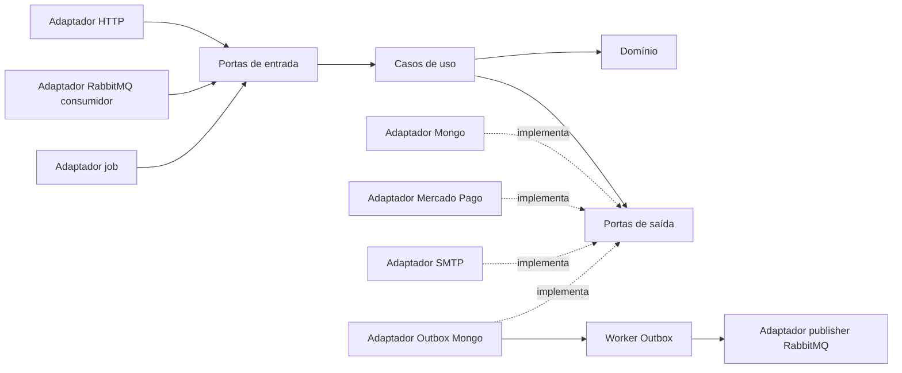

# Arquitetura hexagonal: Ports and Adapters

O Billing adota Ports and Adapters. Domain e Application formam o núcleo. A Application define as portas conforme as necessidades dos casos de uso; os adaptadores dependem dessas portas. CQRS organiza os casos de uso dentro do núcleo.

**DDD estratégico e tático é obrigatório**, conforme [ADR 0005](adr/0005-domain-driven-design.md). O [modelo de domínio e glossário](modelo-dominio.md) define contextos, agregados, value objects e invariantes. Eventos de domínio pertencem ao Domain; eventos internos de integração pertencem à Application; envelopes e contratos externos ficam nos Adapters. A revisão deve verificar o modelo e a localização das regras, além das dependências técnicas.

## Portas e implementações previstas

| Porta | Local | Implementação ou chamador |
|---|---|---|
| IDispatcher / ICommandHandler / IQueryHandler | Application/Ports/In | Implementadas na Application; chamadas por HTTP, RabbitMQ e jobs |
| IBudgetRepository / IPaymentRepository / INotificationRepository | Application/Ports/Out | Repositórios MongoDB |
| IBudgetReadModel / IPaymentReadModel | Application/Ports/Out | Projeções MongoDB retornando DTOs internos |
| IPaymentGateway | Application/Ports/Out | MercadoPagoGateway; requests/responses externos ficam no adaptador |
| IEmailSender | Application/Ports/Out | SMTP; templates HTML ficam no adaptador de e-mail |
| IApprovalTokenService | Application/Ports/Out | Assinatura/verificação HMAC |
| IOutboxWriter | Application/Ports/Out | Grava evento interno em Outbox MongoDB |
| IUnitOfWork | Application/Ports/Out | Transação MongoDB compartilhada por repositórios e Outbox |
| IClock | Application/Ports/Out | SystemClock, substituído por relógio controlado nos testes |

As interfaces não expõem IMongoCollection, IClientSessionHandle, BasicDeliverEventArgs, HttpContext, HttpResponseMessage ou tipos do SDK de pagamento. DTOs, erros e resultados do núcleo são próprios. IDs de sessão, acks de consumo, exchanges e filas, headers e políticas de retry são responsabilidade dos adaptadores. O contrato da unidade de trabalho oferece uma operação transacional neutra; o adaptador associa internamente a sessão aos repositórios/Outbox.

## Fluxos

As setas sólidas indicam fluxo de execução; a dependência de compilação sempre aponta para o núcleo. O host registra todas as implementações no DI.

**Comando RabbitMQ:** adaptador desserializa GearFlow.Contracts, valida versão/envelope e mapeia para GenerateBudgetCommand interno. O handler usa portas para carregar/salvar domínio e registrar evento interno. Transação local confirma Inbox + estado + Outbox. O worker de consumo envia BasicAck após o commit. O worker Outbox traduz o evento interno para o envelope RabbitMQ e publica. A Application não conhece GearFlow.Contracts, exchange/fila ou acknowledgement.

**Aprovação HTTP:** controller valida entrada HTTP e converte para ApproveBudgetCommand. O caso de uso valida o token pela porta, executa Budget.Approve e grava estado + BudgetApprovedEvent no Outbox pela unidade de trabalho. O adaptador HTTP traduz Result/erros para status e HTML/JSON.

**Webhook:** adaptador HTTP preserva os dados necessários à verificação da assinatura pelo componente Mercado Pago e converte a notificação autenticada para command interno. O caso de uso consulta o estado real pela porta IPaymentGateway. Somente o resultado verificado provoca transição de domínio e evento. Modelos e headers do provedor não entram no domínio.

**Consulta:** handler usa IBudgetReadModel/IPaymentReadModel, nunca o driver Mongo. O adaptador retorna DTO interno e o controller monta a resposta HTTP.

**Reconciliação:** BackgroundService é adaptador de entrada que chama o mesmo núcleo por command interno. Não acessa diretamente coleções para alterar regras de domínio.

O worker Outbox é mecanismo de entrega do adaptador, não novo caso de uso. As garantias transacionais e de idempotência estão em [rabbitmq.md](rabbitmq.md); chamadas externas ao MP não são feitas com transação Mongo aberta.

## Verificação prevista na implementação

- Testes de arquitetura impedem Domain de referenciar Application/Adapters/Api e impedem Application de referenciar Adapters/Api/Contracts ou namespaces tecnológicos.
- Testes do núcleo usam portas substituídas por fakes/mocks, sem containers, broker ou servidor HTTP.
- Testes de adaptadores verificam mapeamentos, serialização, transação/Outbox/Inbox, acks de consumo e integrações reais com Testcontainers/WireMock.
- Testes BDD exercitam cenários de negócio pelas portas de entrada; testes HTTP verificam os contratos públicos.

Estrutura completa no [README](../README.md#4-estrutura-da-solution-e-das-pastas). O caminho do host e do Dockerfile permanece `src/GearFlow.Billing.Api`, compatível com o perfil app do Compose.

O modo MercadoPago:UseMock substitui apenas a porta IPaymentGateway por MockPaymentGateway. Confirmação e reembolso são simulados; regras e transações do núcleo são preservadas. IDs MOCK- identificam ordens simuladas; consultas usam a intenção local persistida, sem estado em memória ou rede externa.
