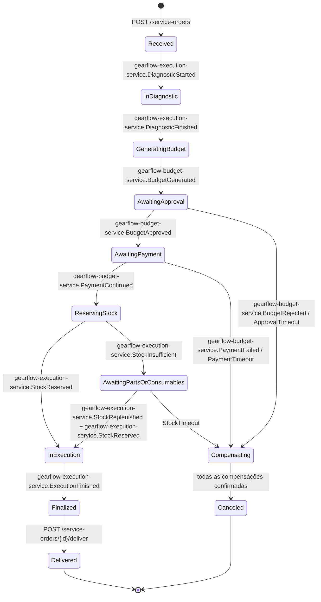
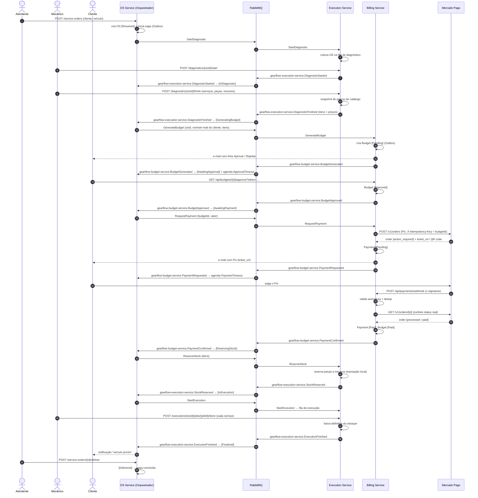
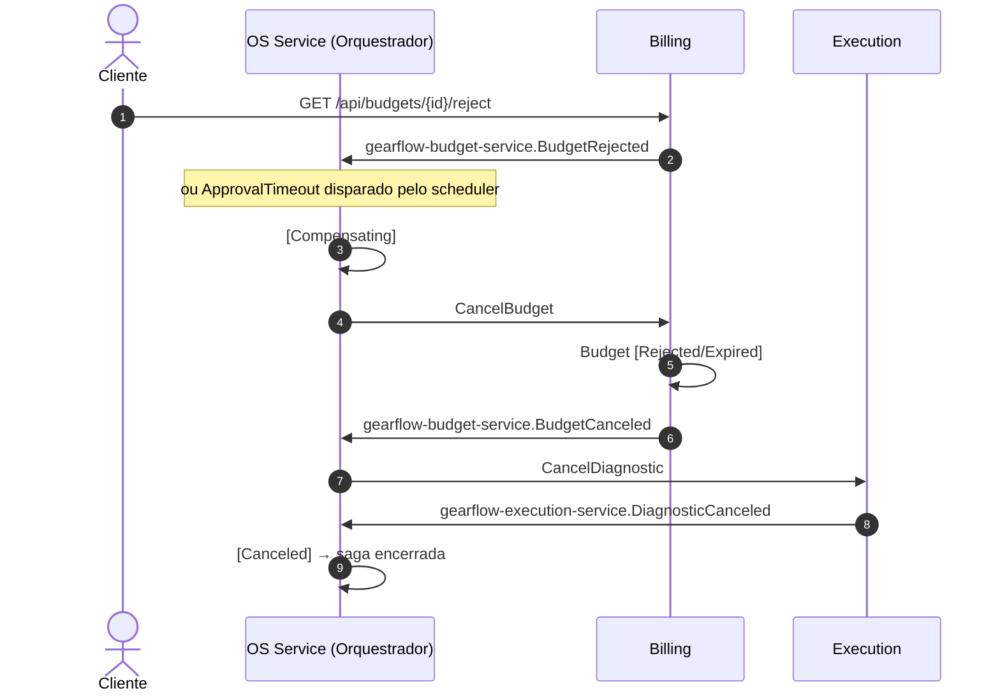
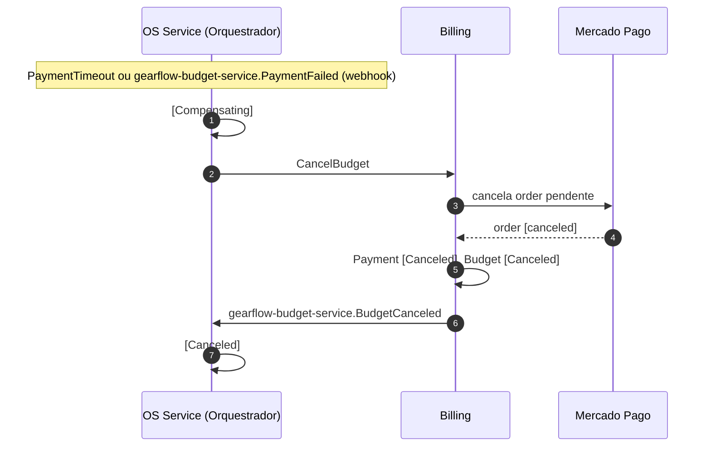
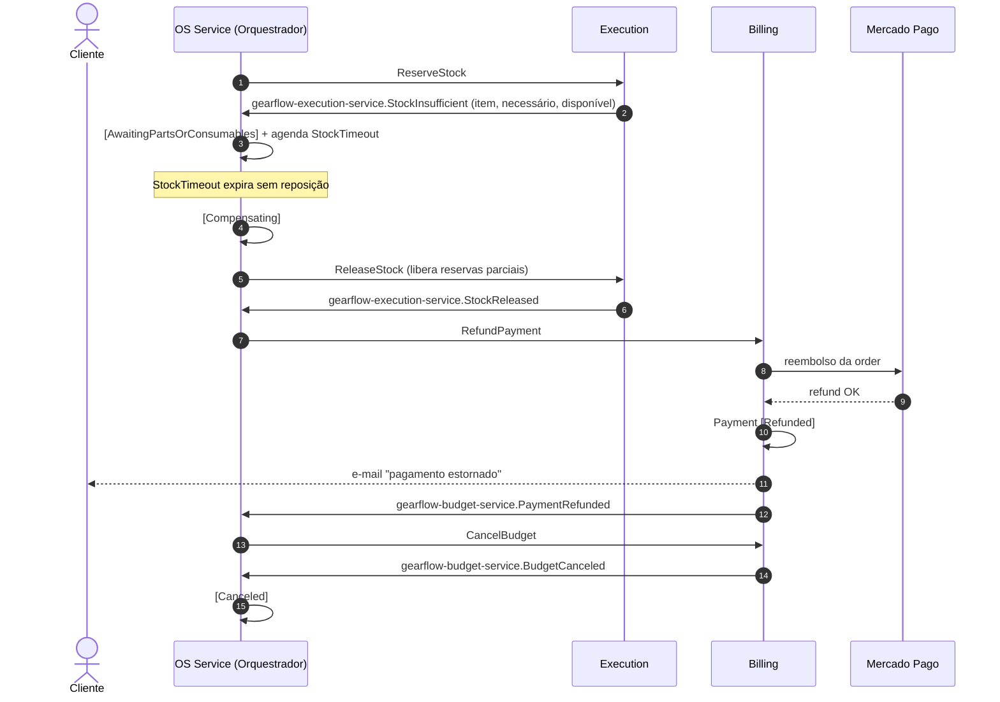

# GearFlow: fluxo completo da Saga (Fase 4)

Para uma leitura guiada de ponta a ponta, consulte o [guia do fluxo completo](README.md).

## 1. Estratégia

**Saga orquestrada.** O orquestrador é uma state machine persistida e roda dentro do **OS Service**. A comunicação passa pelo **RabbitMQ**.

- O orquestrador é o **único** que decide o próximo passo. Os outros serviços só executam comandos e respondem com eventos.
- Cada participante faz uma **transação local + Outbox**: grava estado + Outbox atomicamente no banco; um worker publica no RabbitMQ pelo menos uma vez.
- Toda mensagem leva `CorrelationId = ServiceOrderId`, junto com o trace do OpenTelemetry.
- Todo passo que altera estado tem uma **compensação idempotente**.
- Os timeouts são processados por job persistido no OS Service, sem plugin de agendamento no broker.

**Por que orquestrada e não coreografada:** o fluxo tem muitos passos e várias compensações. Com o fluxo centralizado, o time de 5 pessoas consegue ler, depurar e demonstrar o estado de cada OS num lugar só (a tabela da saga). Na coreografia o fluxo fica espalhado entre os serviços, e é mais difícil saber "em que pé está a OS X".

## 2. Participantes

| Serviço | Banco | Papel na Saga |
|---|---|---|
| **OS Service** | SQL Server | Orquestrador. Abre a OS, guarda o status e o histórico, e mantém o estado da saga |
| **Execution Service** | PostgreSQL | Diagnóstico, catálogo e preços, estoque (reserva e liberação), fila de execução |
| **Billing Service** | MongoDB | Orçamento (aprovação/rejeição), pagamento via **Mercado Pago**, notificações |
| **Mercado Pago** | externo | Cobrança Pix (`/v1/orders`) e webhook de confirmação |

## 3. Passos da Saga e compensações

| # | Comando (orquestrador → serviço) | Serviço | Sucesso | Falha | Compensação |
|---|---|---|---|---|---|
| 1 | *(local)* abrir OS | OS | `gearflow-os-service.ServiceOrderOpened` | erro de validação (HTTP 400) | `CancelServiceOrder` (local) |
| 2 | `StartDiagnostic` | Execution | `gearflow-execution-service.DiagnosticFinished` (itens + preços) | `gearflow-execution-service.DiagnosticFailed` | `CancelDiagnostic` (remove da fila) |
| 3 | `GenerateBudget` | Billing | `gearflow-budget-service.BudgetGenerated` | `gearflow-budget-service.BudgetGenerationFailed` | `CancelBudget` |
| 4 | *(espera o cliente, timeout de aprovação)* | Billing | `gearflow-budget-service.BudgetApproved` | `gearflow-budget-service.BudgetRejected` / timeout | coberto pelo `CancelBudget` |
| 5 | `RequestPayment` | Billing → MP | `gearflow-budget-service.PaymentConfirmed` | `gearflow-budget-service.PaymentFailed` / timeout de pagamento | **`RefundPayment`** (ou cancela a order pendente) |
| 6 | `ReserveStock` | Execution | `gearflow-execution-service.StockReserved` | `gearflow-execution-service.StockInsufficient` → espera reposição até o timeout | **`ReleaseStock`** |
| 7 | `StartExecution` | Execution | `gearflow-execution-service.ExecutionFinished` | `gearflow-execution-service.ExecutionFailed` | *(ponto sem volta: daqui em diante só retry, sem compensação)* |
| 8 | *(local)* entregar | OS | `gearflow-os-service.ServiceOrderDelivered` → saga concluída | — | — |

**Ordem da compensação**: sempre do passo mais recente para o mais antigo.
`ReleaseStock` → `RefundPayment` → `CancelBudget` → `CancelDiagnostic` → OS `Canceled`.

## 4. Estados da OS / Saga

Os status do legado (`ServiceOrderStatusEnum`) foram mantidos. Entram dois novos: **`AwaitingPayment`** e **`Compensating`**.

## 5. Caminho feliz, ponta a ponta

## 6. Cenários de falha (compensação)

### 6.1 Orçamento rejeitado ou timeout de aprovação

### 6.2 Pagamento não realizado ou recusado

### 6.3 Pagou, mas faltou estoque (compensação mais completa: **demo principal**)

### 6.4 Falhas técnicas (serviço fora do ar, MP indisponível)
| Situação | Tratamento |
|---|---|
| Consumer lança exceção | Retry no worker (1s, 5s, 15s), depois fila `<origem>.dlq` + alerta |
| MP retorna 5xx/timeout | Polly (retry + circuit breaker). Se esgotar as tentativas, publica `gearflow-budget-service.PaymentFailed` e a saga compensa |
| Webhook não chegou | Job de **reconciliação** consulta `GET /v1/orders/{id}` dos pagamentos `Pending` |
| Mensagem duplicada | Inbox/dedup por `MessageId` + chaves idempotentes (`BudgetId`, `OsId`) |
| Serviço caiu no meio | A saga fica persistida no SQL Server. Quando o serviço volta, as mensagens pendentes no RabbitMQ são consumidas e o fluxo continua |

## 7. Contratos de mensagens (pacote `GearFlow.Contracts`)

| Mensagem | Tipo | Publicada por | Consumida por |
|---|---|---|---|
| `gearflow-os-service.ServiceOrderOpened` | evento | OS | OS (saga) |
| `StartDiagnostic` / `CancelDiagnostic` | comando | OS | Execution |
| `gearflow-execution-service.DiagnosticStarted` / `gearflow-execution-service.DiagnosticFinished` / `gearflow-execution-service.DiagnosticCanceled` | evento | Execution | OS |
| `GenerateBudget` / `CancelBudget` | comando | OS | Billing |
| `gearflow-budget-service.BudgetGenerated` / `gearflow-budget-service.BudgetApproved` / `gearflow-budget-service.BudgetRejected` / `gearflow-budget-service.BudgetCanceled` | evento | Billing | OS |
| `RequestPayment` / `RefundPayment` | comando | OS | Billing |
| `gearflow-budget-service.PaymentRequested` / `gearflow-budget-service.PaymentConfirmed` / `gearflow-budget-service.PaymentFailed` / `gearflow-budget-service.PaymentRefunded` | evento | Billing | OS |
| `ReserveStock` / `ReleaseStock` / `StartExecution` | comando | OS | Execution |
| `gearflow-execution-service.StockReserved` / `gearflow-execution-service.StockInsufficient` / `gearflow-execution-service.StockReplenished` / `gearflow-execution-service.StockReleased` / `gearflow-execution-service.ExecutionFinished` | evento | Execution | OS |
| `ApprovalTimeout` / `PaymentTimeout` / `StockTimeout` | agendado | OS (scheduler) | OS |

Campos comuns a todas: `CorrelationId` (= `ServiceOrderId`), `MessageId`, `OccurredOn`.

## 8. O que mostrar no vídeo

1. Caminho feliz completo (seção 5), com o trace distribuído aberto na ferramenta de observabilidade.
2. Cenário 6.3: o pagamento é estornado no painel do Mercado Pago e a OS termina `Canceled`.
3. Derrubar o Billing (`kubectl scale --replicas=0`), aprovar o orçamento, subir o Billing de novo e mostrar o fluxo continuando de onde parou.
4. Mostrar a tabela de estado da saga no SQL Server e a DLQ no Management do RabbitMQ.

## 9. RabbitMQ e ambiente local

Consulte [rabbitmq.md](rabbitmq.md) para exchanges, filas e payloads e [ambiente-local.md](ambiente-local.md) para Compose e HTTP. Timeouts são persistidos pelo orquestrador e processados por job; timeouts usam job persistido, sem plugin de agendamento. Diagramas de compensação omitem o broker: toda comunicação entre serviços usa RabbitMQ.

## Fronteira arquitetural

A implementação segue [Ports and Adapters](arquitetura-hexagonal.md). HTTP, consumers RabbitMQ e jobs chamam portas de entrada da Application. MongoDB, Mercado Pago, SMTP e publisher RabbitMQ implementam portas de saída. GearFlow.Contracts e envelopes RabbitMQ ficam nos adaptadores, com mapeamento para commands e eventos internos; o núcleo não referencia tecnologias de transporte ou persistência.

## Pagamento simulado (fluxo atual)

Com MercadoPago:UseMock=true, RequestPayment chama MockPaymentGateway e recebe Paid imediatamente. O Billing grava Payment e Budget como Paid e registra PaymentRequested e PaymentConfirmed no Outbox na mesma transação. A Saga pode continuar ao consumir PaymentConfirmed, sem webhook, Pix real ou chamada HTTP ao Mercado Pago. RefundPayment recebe confirmação simulada e publica PaymentRefunded pelo fluxo existente. Repetições mantêm a idempotência local. Os demais diagramas de interação com o provedor descrevem o modo HTTP opcional (UseMock=false).
